<div align="center">


# Argus

**Ein schneller, moderner und informativer Task-Manager für Windows**

[简体中文](README.md) · [繁體中文](README.zh-TW.md) · [English](README.en.md) · [Español](README.es.md) · **Deutsch** · [日本語](README.ja.md) · [Français](README.fr.md) · [Русский](README.ru.md)

[](https://argustask.com/de/)

Die interaktive Oberfläche und die Funktionsübersicht können auf der [offiziellen Website](https://argustask.com/de/) direkt im Browser ausprobiert werden, ohne Installation.

[](https://github.com/Ray-lea/Argus/releases)
[](https://github.com/Ray-lea/Argus/releases)
[](#system-requirements)
[](LICENSE)

<a href="https://trendshift.io/repositories/310031?utm_source=trendshift-badge&amp;utm_medium=badge&amp;utm_campaign=badge-trendshift-310031" target="_blank" rel="noopener noreferrer"></a>
<a href="https://trendshift.io/repositories/310031?utm_source=trendshift-badge&amp;utm_medium=badge&amp;utm_campaign=badge-trendshift-310031" target="_blank" rel="noopener noreferrer"></a>

[Funktionen](#features) · [Download](#download) · [Aus dem Quellcode bauen](#build-from-source) · [Tastenkombinationen](#keyboard-shortcuts) · [Dokumentation](#documentation) · [Community](#community)

</div>

<br>

<picture>
  <source media="(prefers-color-scheme: dark)" srcset="docs/images/screenshot-en-dark.png">
  
</picture>

<sub>Vorschau mit englischer Benutzeroberfläche.</sub>

<br>

Argus fragt die nativen Windows-APIs direkt über Rust ab. Die Oberfläche verwendet native Komponenten von GPUI Kit; die Diagramme bewegen sich flüssig mit der Bildwiederholrate des Displays. Namensgeber ist Argus Panoptes, der hundertäugige Riese aus der griechischen Mythologie.

<a id="star-history"></a>

## ⭐ GitHub-Sterne

Wenn Argus im Alltag hilfreich ist, unterstützt ein Stern auf GitHub das Projekt und macht es für weitere Interessierte sichtbar.

<a href="https://www.star-history.com/#Ray-lea/Argus&Date">
  <picture>
    <source media="(prefers-color-scheme: dark)" srcset="https://api.star-history.com/svg?repos=Ray-lea/Argus&type=Date&theme=dark">
    
  </picture>
</a>

<a id="features"></a>

## ✨ Funktionen

<table>
<tr>
<td width="50%" valign="top"><picture><source media="(prefers-color-scheme: dark)" srcset="docs/images/features/processes-de-dark.svg"></picture><br><b>Prozesse</b>: Ansicht nach App, als Prozessstruktur oder Liste; suchen, sortieren und ganze Strukturen beenden</td>
<td width="50%" valign="top"><picture><source media="(prefers-color-scheme: dark)" srcset="docs/images/features/performance-de-dark.svg"></picture><br><b>Leistung</b>: CPU-Last je Kern, Takt, Temperatur und Leistungsaufnahme sowie Arbeitsspeicher, Datenträger, Netzwerk und GPU</td>
</tr>
<tr>
<td width="50%" valign="top"><picture><source media="(prefers-color-scheme: dark)" srcset="docs/images/features/history-de-dark.svg"></picture><br><b>Verlauf</b>: ein Klick auf einen Zeitpunkt der 7-Tage-Diagramme zeigt die damals aktivsten Prozesse</td>
<td width="50%" valign="top"><picture><source media="(prefers-color-scheme: dark)" srcset="docs/images/features/files-de-dark.svg"></picture><br><b>Dateisperren</b>: Datei oder Ordner auf das Fenster ziehen, um die verwendenden Prozesse aufzulisten</td>
</tr>
<tr>
<td width="50%" valign="top"><picture><source media="(prefers-color-scheme: dark)" srcset="docs/images/features/rules-de-dark.svg"></picture><br><b>Kontextmenü</b>: Priorität festlegen, Effizienzmodus aktivieren oder eine Regel für jeden Start hinzufügen</td>
<td width="50%" valign="top"><picture><source media="(prefers-color-scheme: dark)" srcset="docs/images/features/ports-de-dark.svg"></picture><br><b>Verbindungen und Ports</b>: Verbindungen und ihre Prozesse nach Port finden und schließen</td>
</tr>
</table>

<table>
<tr>
<td width="50%" valign="top"><b>Dienste und Autostart-Apps</b><br>Dienste starten und beenden, den Starttyp ändern, Autostart-Apps aktivieren oder deaktivieren</td>
<td width="50%" valign="top"><b>Infobereich</b><br><kbd>Ctrl</kbd>+<kbd>Alt</kbd>+<kbd>Esc</kbd> blendet das Fenster jederzeit ein oder aus; ausgeblendet mit geringem Ressourcenbedarf</td>
</tr>
<tr>
<td width="50%" valign="top"><b>Task-Manager ersetzen</b><br>Kann den <a href="docs/architecture/task-manager.md">Windows-Task-Manager ersetzen</a> —Dokumentation auf Chinesisch— und auf <kbd>Ctrl</kbd>+<kbd>Shift</kbd>+<kbd>Esc</kbd> öffnen; führt neue Aufgaben aus und startet den Windows-Explorer neu</td>
<td width="50%" valign="top"><b>Oberfläche und Sprachen</b><br>Mica-Hintergrund, Akzentfarbe sowie helles oder dunkles Design folgen Windows; 8 Oberflächensprachen</td>
</tr>
<tr>
<td width="50%" valign="top"><b>Updates in der Anwendung</b><br>Stabile und Beta-Versionen, Download im Hintergrund, Änderungen in der Anwendung einsehbar</td>
<td width="50%" valign="top"><b>Berechtigungen</b><br>Alle Prozesse sind mit Standardrechten sichtbar; privilegierter Dienst und Administratorstart sind optional</td>
</tr>
</table>

<a id="download"></a>

## 📦 Download

Die aktuelle stabile Version und SHA-256-Prüfsummen stehen auf der [offiziellen Downloadseite](https://argustask.com/de/download/) bereit. Alle Versionen sind unter [GitHub Releases](https://github.com/Ray-lea/Argus/releases) verfügbar.

| Datei | Beschreibung |
|---|---|
| `Argus_<version>_x64-setup.exe` | **Installationsprogramm, empfohlen.** Installiert für alle Benutzer unter `Program Files`. Installation und Updates erfordern Administratorrechte. Unterstützt Updates innerhalb der Anwendung. |
| `Argus_<version>_x64.exe` | **Portable Version.** Direkt ausführbare Einzeldatei, die Einstellungen und Verlauf mit der installierten Version teilt. Automatische Updates werden nicht unterstützt. |
| `SHA256SUMS.txt` | SHA-256-Prüfsummen der veröffentlichten Dateien. |

[Richtlinie zur Codesignierung](#code-signing-policy) · [Datenschutzrichtlinie auf Englisch](PRIVACY.md#english)

<a id="system-requirements"></a>

## 💻 Systemanforderungen

- **Betriebssystem**: Windows 10 22H2, Build 19045, oder neuer, einschließlich Windows 11; nur x64.
- **Grafik**: Grafikgerät und Treiber mit Unterstützung für DirectX 11.

Geprüfte Windows-Versionen, Funktionsunterschiede und erforderliche Berechtigungen beschreibt die [Kompatibilitätsübersicht](docs/guide/hardware-data.md#系统兼容范围) auf Chinesisch.

<a id="build-from-source"></a>

## 🔧 Aus dem Quellcode bauen

Voraussetzungen:

- Rust-Toolchain `stable-x86_64-pc-windows-msvc`, Version 1.100.0 oder neuer.
- Node.js 26.x ab 26.13.1 oder 24.x LTS ab 24.22.3 sowie pnpm 12.18.0.
- Visual Studio Build Tools mit der Workload „Desktopentwicklung mit C++“.

Im Stammverzeichnis des Repositorys mit PowerShell ausführen:

```powershell
.\start.bat           # Entwicklung: Rust- und Ressourcenänderungen lösen Neubau und Neustart aus; bei Fehlern läuft die bisherige Instanz weiter
.\start.bat build     # Release-Build: erzeugt target\release\argus.exe
```

Codeprüfungen, das Erstellen des Installationsprogramms und die Cache-Bereinigung erläutert die [Entwicklungsanleitung](docs/development/README.md) auf Chinesisch.

<a id="keyboard-shortcuts"></a>

## 🔑 Tastenkombinationen

| Aktion | Tasten |
|---|---|
| Seite wechseln | <kbd>Ctrl</kbd>+<kbd>1</kbd> … <kbd>Ctrl</kbd>+<kbd>8</kbd> |
| Prozesse suchen | <kbd>Ctrl</kbd>+<kbd>F</kbd> |
| Aktualisierung vorübergehend anhalten | <kbd>Ctrl</kbd> gedrückt halten; zum Fortsetzen loslassen, auf den Seiten Prozesse und Leistung |
| Details öffnen | <kbd>Enter</kbd> |
| Task beenden | <kbd>Alt</kbd>+<kbd>E</kbd> oder <kbd>Delete</kbd>; <kbd>Shift</kbd>+<kbd>Delete</kbd> überspringt die Bestätigung |
| Fenster global ein- oder ausblenden | <kbd>Ctrl</kbd>+<kbd>Alt</kbd>+<kbd>Esc</kbd> |

Die vollständige Liste steht unter **Einstellungen → Tastenkombinationen → Tastenkombinationen anzeigen**. Weitere Bedienhinweise enthält die [Benutzeranleitung](docs/guide/README.md) auf Chinesisch.

<a id="documentation"></a>

## 📚 Dokumentation

Die ausführliche Dokumentation ist auf Chinesisch verfasst. Die [Online-Dokumentation](https://argustask.com/docs/) bietet eine stabile und eine Entwicklungsausgabe.

| Dokument | Inhalt |
|---|---|
| [Benutzeranleitung](docs/guide/README.md) | Oberfläche und Bedienung, Infobereich und Tastenkombinationen, Einstellungen, Hardwaredaten und deren Grenzen |
| [Entwicklungsanleitung](docs/development/README.md) | Umgebung und Befehle, Builds und Caches, Leistungsreferenzen und Messverfahren |
| [Architektur](docs/architecture/README.md) | Systemschichten, Datenfluss, Technologien und Modulaufgaben |
| [Design](docs/design/README.md) | Gestaltungsprinzipien, Diagrammanimationen, Fenster und Materialien |
| [Bekannte Probleme](docs/known-issues.md) | Bekannte Einschränkungen der aktuellen Version |
| [Änderungsprotokoll](changelog/de-DE.md) | Detaillierte Änderungen jeder Version |

<a id="community"></a>

## 💬 Community

[](https://qm.qq.com/q/97YqJAQRNK) [](https://t.me/argustask)

In der chinesischsprachigen QQ-Gruppe können Probleme gemeldet, Funktionen vorgeschlagen und Erfahrungen ausgetauscht werden. Der Telegram-Kanal veröffentlicht Neuigkeiten zu Versionen und zum Projekt. Beide sind auch über **Info → QQ-Gruppe beitreten** und **Info → Kanal beitreten** in Argus erreichbar.

<a id="contributing"></a>

## 🤝 Mitwirken

Fehlermeldungen und Pull Requests sind willkommen. Vor einer Mitarbeit bitte die [Beitragsrichtlinien](.github/CONTRIBUTING.md) auf Chinesisch lesen. Sicherheitslücken werden vertraulich nach der ebenfalls chinesischsprachigen [Sicherheitsrichtlinie](.github/SECURITY.md) gemeldet.

<a id="roadmap"></a>

## 🧭 Roadmap

Abgeschlossene Meilensteine und die vollständige Planung stehen in der [Roadmap](docs/roadmap.md) auf Chinesisch. Zu den laufenden und geplanten Arbeiten gehören:

- [ ] **Weitere Hardwaresensoren**: Unterstützung zusätzlicher Consumer-Hardware über den offiziellen PawnIO-Treiber; siehe [Hardwareabdeckung](docs/guide/hardware-data.md) auf Chinesisch.
- [ ] **Erweiterte Tastenkombinationen**: linke und rechte Modifikatortasten unterscheiden sowie Kombinationen nur aus Modifikatoren oder aus zwei gewöhnlichen Tasten unterstützen.

<a id="code-signing-policy"></a>

## 🔐 Richtlinie zur Codesignierung

Die kostenlose Codesignierung wird von [SignPath.io](https://about.signpath.io/) bereitgestellt, das Zertifikat von der [SignPath Foundation](https://signpath.org/).

Free code signing provided by [SignPath.io](https://about.signpath.io/), certificate by [SignPath Foundation](https://signpath.org/).

Testsignierung ist integriert. Offizielle Veröffentlichungen werden derzeit ohne Windows-Authenticode-Signaturen ausgeliefert. Sobald die Produktionssignierung aktiviert ist, umfasst sie die Argus-Anwendung, Task-Manager-Hilfsprogramme sowie Deinstallations- und Installationsprogramme, die GitHub Actions aus dem Quellcode dieses Repositorys erstellt. Mitgelieferte Drittprogramme behalten ihre ursprünglichen Signaturen.

- **Codepflege und Reviews**: [@Ray-lea](https://github.com/Ray-lea), zuständig für die Pflege des Codes und die Prüfung externer Beiträge.
- **Freigaben**: [@Ray-lea](https://github.com/Ray-lea), zuständig für die manuelle Genehmigung jeder Produktionssignierung.
- **Datenschutzrichtlinie**: [English](PRIVACY.md#english) · [简体中文](PRIVACY.md#简体中文). Beschreibt standardmäßig aktivierte Updateprüfungen, Proxy-Ausweichrouten, PawnIO-Downloads bei Bedarf, freiwillige Rückmeldungen und die Datenverarbeitung durch Dritte.

Updates innerhalb der Anwendung verwenden einen separaten Minisign-Veröffentlichungsschlüssel zur Prüfung von Installationspaketen und Versionsnummern. Windows Authenticode identifiziert den Unterzeichner einer ausführbaren Datei.

<a id="acknowledgements"></a>

## 🙏 Danksagungen

Argus baut auf den folgenden Open-Source-Projekten auf:

| Projekt | Verwendung |
|---|---|
| [GPUI Kit](https://gpui-kit.com/) | Native Desktopkomponenten, Fenster, Tabellen und Diagramme |
| [windows-rs](https://github.com/microsoft/windows-rs) | Rust-Anbindungen an native Windows-APIs |
| [Biome](https://biomejs.dev/), [NSIS](https://nsis.sourceforge.io/) | Entwicklungsprüfungen und Windows-Paketierung |
| [serde](https://serde.rs/), [reqwest](https://github.com/seanmonstar/reqwest) und weitere Rust-Crates | Serialisierung, Netzwerkanfragen und weitere Grundlagen |
| [PawnIO](https://pawnio.eu/), [PawnIO.Modules](https://github.com/namazso/PawnIO.Modules) | Signierter Treiber und Erfassungsmodule für die optionalen Kernelsensoren |
| [ZenStates-Core](https://github.com/irusanov/ZenStates-Core), [LibreHardwareMonitor](https://github.com/LibreHardwareMonitor/LibreHardwareMonitor), [GNR-SMU](https://github.com/Kyworn/gnr-smu) | Referenzen für CPU-Registerlayouts, etwa AMD-SMU-Tabellen |
| [Intel IGCL](https://github.com/intel/drivers.gpu.control-library), [AMD ADL](https://github.com/GPUOpen-LibrariesAndSDKs/display-library) | Schnittstellen für GPU-Telemetrie |

Alle Drittkomponenten und ihre Lizenzhinweise sind in [THIRD-PARTY-NOTICES.txt](THIRD-PARTY-NOTICES.txt) aufgeführt.

Vielen Dank an die Community [LINUX DO](https://linux.do/) für ihre Unterstützung.

<!-- supporters:start · node scripts/supporters.mjs -->
<p align="center">
  <a href="https://github.com/bronyaicu" target="_blank" rel="noopener"><picture><source media="(prefers-color-scheme: dark)" srcset="docs/images/supporters/bronyaicu-de-dark.svg"></picture></a>
</p>
<!-- supporters:end -->

<a id="license"></a>

## 📄 Lizenz

Argus ist freie Software unter der [GNU Affero General Public License](LICENSE), Version 3 oder (nach eigener Wahl) einer späteren Version (`AGPL-3.0-or-later`).

<a href="https://next.ossinsight.io/widgets/official/compose-recent-active-contributors?repo_id=1415551131&limit=30" target="_blank" style="display: block" align="center">
  <picture>
    <source media="(prefers-color-scheme: dark)" srcset="https://next.ossinsight.io/widgets/official/compose-recent-active-contributors/thumbnail.png?repo_id=1415551131&limit=30&image_size=auto&color_scheme=dark" width="655" height="auto">
    
  </picture>
</a>

<!-- Made with [OSS Insight](https://ossinsight.io/) -->

<div align="center">
<br>
<sub>Argus · Task-Manager für Windows · © 2026 Argus contributors</sub>
</div>
