<div align="center">


# Argus

**A fast, modern, information-rich Windows task manager**

[简体中文](README.md) · [繁體中文](README.zh-TW.md) · **English** · [Español](README.es.md) · [Deutsch](README.de.md) · [日本語](README.ja.md) · [Français](README.fr.md) · [Русский](README.ru.md)

[](https://argustask.com/en/)

Try the full interactive interface and guided tour right in your browser on the [official website](https://argustask.com/en/) — no installation required

[](https://github.com/Ray-lea/Argus/releases)
[](https://github.com/Ray-lea/Argus/releases)
[](#-system-requirements)
[](LICENSE)

<a href="https://trendshift.io/repositories/310031?utm_source=trendshift-badge&amp;utm_medium=badge&amp;utm_campaign=badge-trendshift-310031" target="_blank" rel="noopener noreferrer"></a>
<a href="https://trendshift.io/repositories/310031?utm_source=trendshift-badge&amp;utm_medium=badge&amp;utm_campaign=badge-trendshift-310031" target="_blank" rel="noopener noreferrer"></a>

[Features](#-features) · [Download](#-download) · [Build from source](#-build-from-source) · [Keyboard shortcuts](#-keyboard-shortcuts) · [Documentation](#-documentation) · [Community](#-community)

</div>

<br>

<picture>
  <source media="(prefers-color-scheme: dark)" srcset="docs/images/screenshot-en-dark.png">
  
</picture>

<br>

Argus queries Windows native APIs directly in Rust, with an interface built on GPUI Kit native components and charts that flow smoothly at the display's refresh rate. The project is named after Argus Panoptes, the hundred-eyed giant of Greek mythology.

## ⭐ Star history

If Argus is useful in your daily workflow, please consider giving it a star on GitHub. It is the most direct way to support the project and helps more people discover it.

<a href="https://www.star-history.com/#Ray-lea/Argus&Date">
  <picture>
    <source media="(prefers-color-scheme: dark)" srcset="https://api.star-history.com/svg?repos=Ray-lea/Argus&type=Date&theme=dark">
    
  </picture>
</a>

## ✨ Features

<table>
<tr>
<td width="50%" valign="top"><picture><source media="(prefers-color-scheme: dark)" srcset="docs/images/features/processes-en-dark.svg"></picture><br><b>Processes</b>: browse by app, process tree, or list; search, sort, and end a whole tree</td>
<td width="50%" valign="top"><picture><source media="(prefers-color-scheme: dark)" srcset="docs/images/features/performance-en-dark.svg"></picture><br><b>Performance</b>: per-core CPU load, speed, temperature, and power, plus memory, disks, network, and GPU</td>
</tr>
<tr>
<td width="50%" valign="top"><picture><source media="(prefers-color-scheme: dark)" srcset="docs/images/features/history-en-dark.svg"></picture><br><b>History</b>: click any moment on the 7-day charts to see the busiest processes at that time</td>
<td width="50%" valign="top"><picture><source media="(prefers-color-scheme: dark)" srcset="docs/images/features/files-en-dark.svg"></picture><br><b>File locks</b>: drop a file or folder onto the window to list the processes using it</td>
</tr>
<tr>
<td width="50%" valign="top"><picture><source media="(prefers-color-scheme: dark)" srcset="docs/images/features/rules-en-dark.svg"></picture><br><b>Context menu</b>: set priority, turn on Efficiency mode, or add a rule that applies at every start</td>
<td width="50%" valign="top"><picture><source media="(prefers-color-scheme: dark)" srcset="docs/images/features/ports-en-dark.svg"></picture><br><b>Connections and ports</b>: find connections and their processes by port, and close them</td>
</tr>
</table>

<table>
<tr>
<td width="50%" valign="top"><b>Services and startup apps</b><br>Start and stop services, change their startup type, and enable or disable startup apps</td>
<td width="50%" valign="top"><b>System tray</b><br><kbd>Ctrl</kbd>+<kbd>Alt</kbd>+<kbd>Esc</kbd> shows or hides the window at any time; minimal resource use while hidden</td>
</tr>
<tr>
<td width="50%" valign="top"><b>Task Manager replacement</b><br>Can <a href="docs/architecture/task-manager.md">replace Windows Task Manager</a> (in Chinese) and open on <kbd>Ctrl</kbd>+<kbd>Shift</kbd>+<kbd>Esc</kbd>; runs new tasks and restarts Windows Explorer</td>
<td width="50%" valign="top"><b>Look and languages</b><br>Mica backdrop, following the system accent color and light or dark theme; 8 interface languages</td>
</tr>
<tr>
<td width="50%" valign="top"><b>In-app updates</b><br>Stable and Beta channels, background downloads, and release notes in the app</td>
<td width="50%" valign="top"><b>Permissions</b><br>Every process is visible to a standard user; the privileged service and administrator startup are optional</td>
</tr>
</table>

## 📦 Download

Get the latest stable build and SHA-256 checksums from the [official download page](https://argustask.com/en/download/). All versions are available on [GitHub Releases](https://github.com/Ray-lea/Argus/releases).

| File | Description |
|---|---|
| `Argus_<version>_x64-setup.exe` | **Installer (recommended).** Installs for all users into `Program Files`; installing and updating require administrator permission. Supports in-app updates. |
| `Argus_<version>_x64.exe` | **Portable version.** Runs directly as a standalone executable and shares settings and history with the installed version; does not support automatic updates. |
| `SHA256SUMS.txt` | SHA-256 checksums of the release files above. |

[Code signing policy](#code-signing-policy) · [Privacy policy](PRIVACY.md#english)

## 💻 System requirements

- **Operating system**: Windows 10 version 22H2 (build 19045) or later, including Windows 11 (x64 only)
- **Graphics**: a graphics device and driver supporting DirectX 11

See [compatibility](docs/guide/hardware-data.md#系统兼容范围) (in Chinese) for tested Windows versions, feature differences, and permission requirements.

## 🔧 Build from source

Prerequisites:

- Rust `stable-x86_64-pc-windows-msvc` toolchain (1.100.0 or later)
- Node.js 26.x from 26.13.1 (24.x LTS from 24.22.3 is also supported) and pnpm 12.18.0
- Visual Studio Build Tools ("Desktop development with C++" workload)

Run the following commands in PowerShell from the repository root:

```powershell
.\start.bat           # development mode: Rust and resource changes rebuild and restart automatically; a failed build keeps the running instance
.\start.bat build     # release build: outputs target\release\argus.exe
```

For code checks, packaging the installer, and cleaning caches, see the [development guide](docs/development/README.md) (in Chinese).

## 🔑 Keyboard shortcuts

| Action | Keys |
|---|---|
| Switch pages | <kbd>Ctrl</kbd>+<kbd>1</kbd> … <kbd>Ctrl</kbd>+<kbd>8</kbd> |
| Search processes | <kbd>Ctrl</kbd>+<kbd>F</kbd> |
| Temporarily pause updates | Hold <kbd>Ctrl</kbd>; release to resume (Processes and Performance) |
| Open details | <kbd>Enter</kbd> |
| End task | <kbd>Alt</kbd>+<kbd>E</kbd> or <kbd>Delete</kbd> (<kbd>Shift</kbd>+<kbd>Delete</kbd> skips the confirmation) |
| Show or hide the window (global) | <kbd>Ctrl</kbd>+<kbd>Alt</kbd>+<kbd>Esc</kbd> |

The full shortcut list is available in Settings → Keyboard shortcuts → View shortcuts, and further usage details are covered in the [user guide](docs/guide/README.md) (in Chinese).

## 📚 Documentation

The documentation is in Chinese; [online documentation](https://argustask.com/docs/) (both stable and development editions) is also available.

| Document | Overview |
|---|---|
| [User guide](docs/guide/README.md) | Interface and operations, background tray and shortcuts, settings, hardware data sources and limitations |
| [Development guide](docs/development/README.md) | Environment and commands, builds and caches, performance baselines and measurement |
| [Architecture](docs/architecture/README.md) | System layers and data flow, tech stack, module responsibilities |
| [Design](docs/design/README.md) | Design principles, chart animation, window appearance and materials |
| [Known issues](docs/known-issues.md) | Known limitations of the current version |
| [Changelog](changelog/en-US.md) | Detailed changes in each release |

## 💬 Community

[](https://qm.qq.com/q/97YqJAQRNK) [](https://t.me/argustask)

Join the Chinese-speaking QQ group to report problems, suggest features, or share experiences with other users. The Telegram channel posts release updates and project news. Both are also accessible from Argus via About → Join QQ group and About → Join channel.

## 🤝 Contributing

Issues and pull requests are welcome; please read the [contributing guide](.github/CONTRIBUTING.md) (in Chinese) first. Report security vulnerabilities privately as described in the [security policy](.github/SECURITY.md) (in Chinese).

## 🧭 Roadmap

See the [roadmap](docs/roadmap.md) (in Chinese) for completed milestones and the full plan. Ongoing and planned work includes:

- [ ] **Expanded hardware sensors**: continuing to broaden consumer hardware sensor coverage through the official PawnIO driver (see [hardware coverage](docs/guide/hardware-data.md), in Chinese)
- [ ] **Extended keyboard shortcuts**: distinguishing left and right modifiers, and supporting combinations of only modifier keys or of two non-modifier keys

<a id="code-signing-policy"></a>

## 🔐 Code signing policy

Free code signing provided by [SignPath.io](https://about.signpath.io/), certificate by [SignPath Foundation](https://signpath.org/).

Test signing is integrated; official releases currently ship without Windows Authenticode signatures. Once production signing is enabled, it will cover the Argus application, Task Manager helpers, uninstaller, and installer built from this repository's source by GitHub Actions. Bundled third-party programs retain their original signatures.

- **Committers and reviewers**: [@Ray-lea](https://github.com/Ray-lea), responsible for maintaining the code and reviewing external contributions.
- **Approvers**: [@Ray-lea](https://github.com/Ray-lea), responsible for manually approving each production signing request.
- **Privacy policy**: [English](PRIVACY.md#english) · [简体中文](PRIVACY.md#简体中文). Covers update checks enabled by default, proxy fallback, on-demand PawnIO downloads, voluntary feedback, and third-party data handling.

In-app updates use a separate Minisign release key to verify installers and version numbers; Windows Authenticode identifies the signer of an executable.

## 🙏 Acknowledgements

Argus is built upon the following open-source projects, with sincere thanks:

| Project | Used for |
|---|---|
| [GPUI Kit](https://gpui-kit.com/) | Native desktop components, windows, tables, and charts |
| [windows-rs](https://github.com/microsoft/windows-rs) | Rust bindings for Windows native APIs |
| [Biome](https://biomejs.dev/), [NSIS](https://nsis.sourceforge.io/) | Development checks and Windows packaging |
| [serde](https://serde.rs/), [reqwest](https://github.com/seanmonstar/reqwest) and other Rust crates | Serialization, networking, and other foundational functionality |
| [PawnIO](https://pawnio.eu/), [PawnIO.Modules](https://github.com/namazso/PawnIO.Modules) | Signed driver and collection modules behind the optional kernel sensors |
| [ZenStates-Core](https://github.com/irusanov/ZenStates-Core), [LibreHardwareMonitor](https://github.com/LibreHardwareMonitor/LibreHardwareMonitor), [GNR-SMU](https://github.com/Kyworn/gnr-smu) | CPU register layout references such as AMD SMU tables |
| [Intel IGCL](https://github.com/intel/drivers.gpu.control-library), [AMD ADL](https://github.com/GPUOpen-LibrariesAndSDKs/display-library) | GPU telemetry interfaces |

All third-party components and their license notices are listed in [THIRD-PARTY-NOTICES.txt](THIRD-PARTY-NOTICES.txt).

Thanks to the [LINUX DO](https://linux.do/) community for its support.

<!-- supporters:start · node scripts/supporters.mjs -->
<p align="center">
  <a href="https://github.com/bronyaicu" target="_blank" rel="noopener"><picture><source media="(prefers-color-scheme: dark)" srcset="docs/images/supporters/bronyaicu-en-dark.svg"></picture></a>
</p>
<!-- supporters:end -->

## 📄 License

Argus is free software, released under the [GNU Affero General Public License](LICENSE), version 3 or (at your option) any later version (`AGPL-3.0-or-later`).

<a href="https://next.ossinsight.io/widgets/official/compose-recent-active-contributors?repo_id=1415551131&limit=30" target="_blank" style="display: block" align="center">
  <picture>
    <source media="(prefers-color-scheme: dark)" srcset="https://next.ossinsight.io/widgets/official/compose-recent-active-contributors/thumbnail.png?repo_id=1415551131&limit=30&image_size=auto&color_scheme=dark" width="655" height="auto">
    
  </picture>
</a>

<!-- Made with [OSS Insight](https://ossinsight.io/) -->

<div align="center">
<br>
<sub>Argus · Task manager for Windows · © 2026 Argus contributors</sub>
</div>
