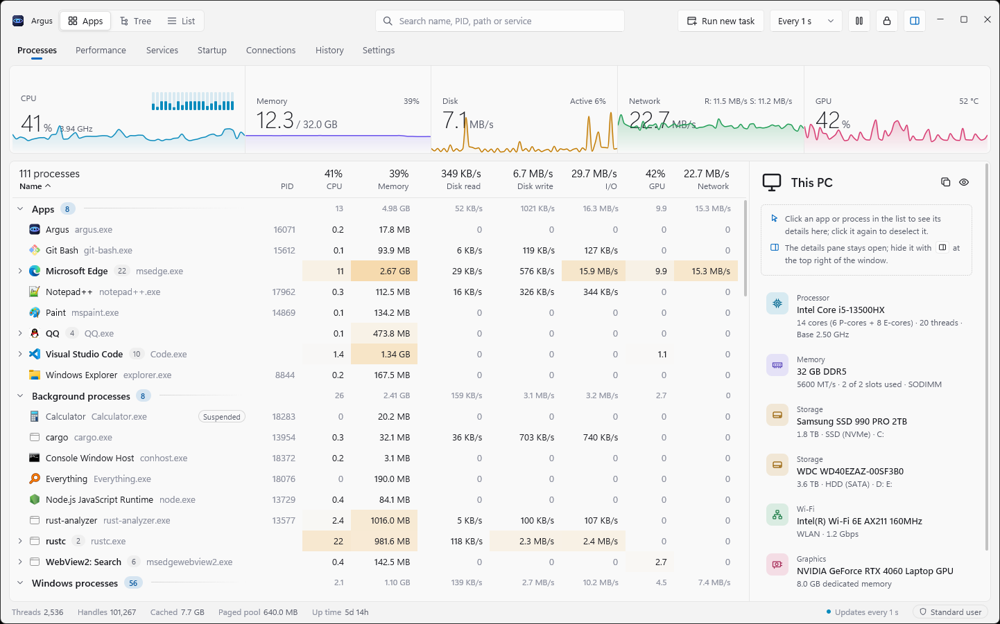

<div align="center">


# Argus

**A fast, modern and informative task manager for Windows**

[简体中文](README.md) · **English**

[](https://github.com/Ray-lea/Argus/releases)
[](https://github.com/Ray-lea/Argus/releases)
[](#-system-requirements)
[](LICENSE)

[](https://www.rust-lang.org/)
[](https://tauri.app/)
[](https://www.solidjs.com/)
[](https://www.typescriptlang.org/)

[Features](#-features) · [Download](#-download) · [Build from source](#-build-from-source) · [Keyboard shortcuts](#-keyboard-shortcuts) · [Documentation](#-documentation) · [Community](#-community)

</div>

<br>

<picture>
  <source media="(prefers-color-scheme: dark)" srcset="docs/images/screenshot-en-dark.png">
  
</picture>

<br>

Argus reads Windows' native interfaces directly from Rust, with an interface built on Tauri 2 and SolidJS. Processes, performance, services, startup apps, network connections and the last 7 days of history share one window, and the charts move smoothly at the display's refresh rate; resident in the system tray, it uses about 1% of one CPU core. It is named after Argus Panoptes, the hundred-eyed giant of Greek myth.

## ⭐ Star history

If Argus is useful to you, please consider giving it a star on GitHub. It is the most direct way to support the project, and it helps more people find it.

<a href="https://www.star-history.com/#Ray-lea/Argus&Date">
  <picture>
    <source media="(prefers-color-scheme: dark)" srcset="https://api.star-history.com/svg?repos=Ray-lea/Argus&type=Date&theme=dark">
    
  </picture>
</a>

## ✨ Features

| | Feature | Description |
|:---:|---|---|
| 🧮 | **Processes** | View by app, as a process tree or as a list, including each process's disk read and write rates and GPU usage, plus network traffic when the privileged service is enabled or Argus runs as administrator. Sort, search, end a process or its whole tree; the details pane shows the command line, user, integrity level and more. |
| ⚡ | **Priority and efficiency mode** | Set them from the context menu, or create rules that apply them every time a program starts. |
| 📈 | **Performance** | CPU (per core, P-cores and E-cores, frequency, temperature, power), memory, disks, network, GPU and battery. |
| 🧩 | **Services and startup apps** | Start and stop services and change their startup type; enable or disable startup apps with the same switch as Windows Task Manager. |
| 🌐 | **Connections and ports** | TCP and UDP endpoints with the processes they belong to; search by exact port and close connections. |
| 🔍 | **File locks** | Drop a file or folder onto the window to find the processes using it, combining Restart Manager with handle enumeration, including processes' current directories; the privileged service can check more processes. |
| 🕘 | **History** | Resource charts for the last 7 days; click any moment to see the busiest processes at that time. |
| 📌 | **System tray** | Show or hide the window with the global shortcut Ctrl+Alt+Esc (which can be changed or turned off); it uses very little while hidden, and the refresh rates while minimized and in the tray can be set separately. |
| 🔄 | **In-app updates** | New versions download in the background and are announced in the title bar, with everything that changed since your version shown before installing; after updating, Argus shows what the new version changed the first time its window opens. Stable and beta channels, with optional GitHub proxies; only updates that pass signature verification are installed. |
| 🎨 | **Native look** | Mica on Windows 11 and a solid background on Windows 10; the system accent color and light or dark theme follow Windows by default, with a theme override in Settings. |
| 🌍 | **Languages** | English and Simplified Chinese, following the Windows display language by default; a welcome guide sets up the essentials on first start. |
| 👤 | **No administrator rights needed** | See the path and resource usage of every process as a standard user. |
| 🛡️ | **Optional privileged service** | After a single administrator approval, Argus running as a standard user can also manage system processes, apply rules automatically, measure per-process network traffic (and disk reads and writes on Windows 10 and Windows 11 versions before 24H2), control services and close connections; it can be uninstalled in Settings. |
| 🪟 | **Tasks and desktop** | Run new tasks from any page, optionally as administrator, or restart the current desktop's Windows Explorer. |

## 📦 Download

Get the latest version from [GitHub Releases](https://github.com/Ray-lea/Argus/releases):

| File | Description |
|---|---|
| `Argus_<version>_x64-setup.exe` | **Installer (recommended).** Installs for all users into Program Files; installing and updating require administrator permission. Supports in-app updates. |
| `Argus_<version>_x64.exe` | **Portable version.** Runs directly and shares settings and data with the installed version; no automatic updates. |
| `SHA256SUMS.txt` | SHA-256 checksums of the files above. |

> [!NOTE]
> Argus is not code-signed yet, so Windows SmartScreen may warn about an "unknown publisher" the first time it runs.

## 💻 System requirements

- Windows 10 version 22H2 (build 19045) or later, including Windows 11; x64 only
- WebView2 Runtime (included in Windows 11)

See [compatibility](docs/guide/hardware-data.md#系统兼容范围) (Chinese) for tested Windows versions, feature differences and permission requirements.

## 🔧 Build from source

Requires Rust (stable, MSVC toolchain), Node.js 22.18 or later (23.6 or later on 23.x), pnpm, and Visual Studio Build Tools ("Desktop development with C++"). In the repository root:

```bash
start.bat           # development mode: instant frontend reload; Rust changes rebuild and restart automatically
start.bat build     # release build: target\release\argus.exe
```

For the browser preview, checks, packaging the installer and cleaning caches, see the [development guide](docs/development/README.md) (in Chinese).

## 🔑 Keyboard shortcuts

| Action | Keys |
|---|---|
| Switch pages | <kbd>Ctrl</kbd>+<kbd>1</kbd> … <kbd>Ctrl</kbd>+<kbd>7</kbd> |
| Search processes | <kbd>Ctrl</kbd>+<kbd>F</kbd> |
| Temporarily pause updates | Hold <kbd>Ctrl</kbd>; release to resume (Processes and Performance) |
| Open details | <kbd>Enter</kbd> |
| End task | <kbd>Alt</kbd>+<kbd>E</kbd> or <kbd>Delete</kbd> (<kbd>Shift</kbd>+<kbd>Delete</kbd> skips the confirmation) |
| Show or hide the window (global) | <kbd>Ctrl</kbd>+<kbd>Alt</kbd>+<kbd>Esc</kbd> |

The full reference is available in Settings → Keyboard shortcuts → View shortcuts.

The [user guide](docs/guide/README.md) covers everything else.

## 📚 Documentation

The documentation is in Chinese.

| Document | Contents |
|---|---|
| [User guide](docs/guide/README.md) | Interface and operations, tray and shortcuts, settings, where hardware data comes from |
| [Development guide](docs/development/README.md) | Environment and commands, builds and caches, performance baselines and measurement |
| [Architecture](docs/architecture/README.md) | Layers and data flow, module responsibilities |
| [Design](docs/design/README.md) | Design principles, chart animation, window appearance |
| [Roadmap](docs/roadmap.md) | Done and planned features |
| [Known issues](docs/known-issues.md) | Limitations of the current version |
| [Changelog](CHANGELOG.md) | Changes in each version |

## 💬 Community

[](https://qm.qq.com/q/97YqJAQRNK)

Join the QQ group **453803497** (Chinese-speaking) to report problems, suggest features or talk with other users: click the badge above or [this link](https://qm.qq.com/q/97YqJAQRNK) to open the invitation. In Argus, Settings → About has a “Join QQ group” button as well.

## 🤝 Contributing

Issues and pull requests are welcome; please read the [contributing guide](.github/CONTRIBUTING.md) first. Report security vulnerabilities privately as described in the [security policy](.github/SECURITY.md), not in public issues.

## 🧭 Roadmap

- [x] **M0–M3**: processes, performance, services, startup apps, network connections and file locks
- [x] Languages, the welcome guide and in-app updates
- [ ] **M4**: per-process GPU usage and disk reads and writes, priority and efficiency mode rules, and history are done; per-process network traffic through ETW is in progress
- [ ] **M5**: the optional privileged service, rules and network collection through it, and file locks by handle are done; [Task Manager replacement](docs/architecture/task-manager.md) (Chinese) is in progress
- [x] Optional CPU kernel sensors: per-core readings, effective clocks, voltage and power limits, with automatic setup of the official PawnIO driver; AMD/Intel GPU telemetry; [hardware coverage](docs/guide/hardware-data.md) (Chinese)
- [ ] More keyboard shortcuts: telling left and right modifiers apart, and combinations of modifiers only or of two ordinary keys

See the [roadmap](docs/roadmap.md) for details.

## 🙏 Acknowledgements

Argus is built on the following open-source projects, with thanks:

| Project | Used for |
|---|---|
| [Tauri](https://tauri.app/) and its plugins | App host, tray, start at sign-in and in-app updates |
| [WebView2](https://developer.microsoft.com/microsoft-edge/webview2/), [webview2-com](https://github.com/wravery/webview2-rs) | Rendering the interface |
| [windows-rs](https://github.com/microsoft/windows-rs) | Rust bindings for Windows' native interfaces |
| [SolidJS](https://www.solidjs.com/), [TanStack Virtual](https://tanstack.com/virtual) | UI framework and virtual scrolling for long lists |
| [Vite](https://vite.dev/), [Tailwind CSS](https://tailwindcss.com/), [TypeScript](https://www.typescriptlang.org/), [Biome](https://biomejs.dev/) | Frontend build, styling and linting |
| [serde](https://serde.rs/), [reqwest](https://github.com/seanmonstar/reqwest) and other Rust crates | Serialization, HTTP and other groundwork |
| [PawnIO](https://pawnio.eu/), [PawnIO.Modules](https://github.com/namazso/PawnIO.Modules) | Signed driver and modules behind the optional kernel sensors |
| [ZenStates-Core](https://github.com/irusanov/ZenStates-Core), [LibreHardwareMonitor](https://github.com/LibreHardwareMonitor/LibreHardwareMonitor), [GNR-SMU](https://github.com/Kyworn/gnr-smu) | CPU register layouts such as AMD SMU tables |
| [Intel IGCL](https://github.com/intel/drivers.gpu.control-library), [AMD ADL](https://github.com/GPUOpen-LibrariesAndSDKs/display-library) | GPU telemetry interfaces |

All third-party components and their licenses are listed in [THIRD-PARTY-NOTICES.txt](THIRD-PARTY-NOTICES.txt).

Thanks to the [LINUX DO](https://linux.do/) community for its support.

## 📄 License

Argus is free software, released under the [GNU Affero General Public License](LICENSE), version 3 or (at your option) any later version (AGPL-3.0-or-later).

<div align="center">
<br>
<sub>Argus · Task manager for Windows · © 2026 Argus contributors</sub>
</div>
