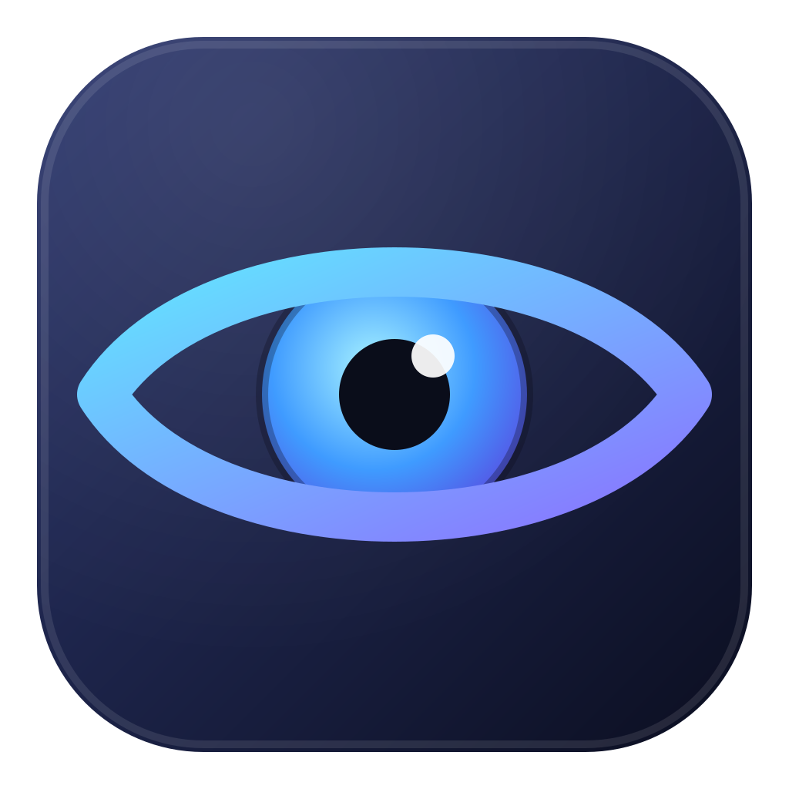
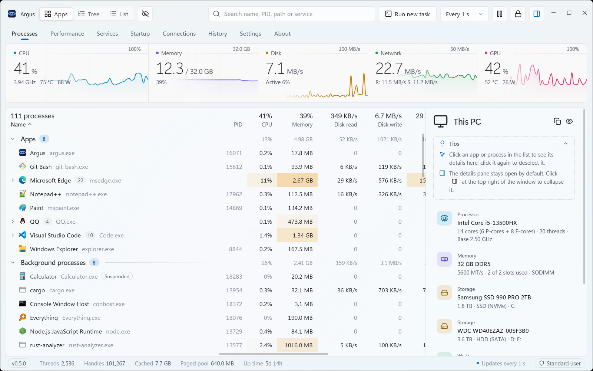

<div align="center">



# Argus

**Un administrador de tareas para Windows rápido, moderno y con información detallada**

[简体中文](README.md) · [繁體中文](README.zh-TW.md) · [English](README.en.md) · **Español** · [Deutsch](README.de.md) · [日本語](README.ja.md) · [Français](README.fr.md) · [Русский](README.ru.md)

[](https://argustask.com/es/)

Explore la interfaz interactiva y el recorrido de funciones en el [sitio oficial](https://argustask.com/es/) desde el navegador, sin instalar la aplicación.

[](https://github.com/Ray-lea/Argus/releases)
[](https://github.com/Ray-lea/Argus/releases)
[](#system-requirements)
[](LICENSE)

[Funciones](#features) · [Descarga](#download) · [Compilar desde el código fuente](#build-from-source) · [Atajos de teclado](#keyboard-shortcuts) · [Documentación](#documentation) · [Comunidad](#community)

</div>

<br>

<picture>
  <source media="(prefers-color-scheme: dark)" srcset="docs/images/screenshot-en-dark.png">
  
</picture>

<sub>Vista previa de la interfaz en inglés.</sub>

<br>

Argus consulta directamente las API nativas de Windows mediante Rust. Su interfaz utiliza componentes nativos de GPUI Kit y gráficos que se desplazan con fluidez a la frecuencia de actualización de la pantalla. El nombre procede de Argos Panoptes, el gigante de cien ojos de la mitología griega.

<a id="star-history"></a>

## ⭐ Historial de estrellas

Si Argus resulta útil en el trabajo diario, una estrella en GitHub es una forma directa de apoyar el proyecto y ayudar a que más personas lo descubran.

<a href="https://www.star-history.com/#Ray-lea/Argus&Date">
  <picture>
    <source media="(prefers-color-scheme: dark)" srcset="https://api.star-history.com/svg?repos=Ray-lea/Argus&type=Date&theme=dark">
    
  </picture>
</a>

<a id="features"></a>

## ✨ Funciones

| | Función | Descripción |
|:---:|---|---|
| 🧮 | **Procesos** | Vistas por aplicación, árbol de procesos o lista, con uso de CPU, memoria, lectura y escritura de disco, tráfico de red y GPU en tiempo real. Permite ordenar, buscar y finalizar procesos o árboles completos; el panel de detalles muestra la línea de comandos, el usuario, el nivel de integridad y otros datos. |
| ⚡ | **Prioridad y modo de eficiencia** | Ajustes inmediatos desde el menú contextual o mediante reglas que se aplican cada vez que se inicia un programa. |
| 📈 | **Rendimiento** | Supervisión detallada de CPU —carga por núcleo, núcleos P y E, frecuencia, temperatura y potencia—, memoria, discos —incluidos estado y atributos SMART—, red, GPU y batería. |
| 🧩 | **Servicios y aplicaciones de inicio** | Iniciar y detener servicios de Windows, cambiar su tipo de inicio y activar o desactivar aplicaciones de inicio, con el mismo estado que el Administrador de tareas de Windows. |
| 🌐 | **Conexiones y puertos** | Consultar los extremos TCP y UDP activos y sus procesos, filtrar por un puerto exacto y cerrar conexiones. |
| 🔍 | **Archivos en uso** | Arrastrar un archivo o carpeta a la ventana para encontrar los procesos que lo utilizan. Combina Restart Manager con la enumeración de identificadores, incluidos los directorios de trabajo de los procesos. |
| 🕘 | **Historial** | Registra automáticamente el uso de recursos de los últimos 7 días. Al seleccionar un instante se muestran los procesos con mayor actividad en ese momento. |
| 📌 | **Bandeja del sistema** | Un atajo global permite mostrar u ocultar la ventana. El consumo de recursos es mínimo mientras está oculta; los intervalos de actualización al minimizar y al permanecer en la bandeja se configuran por separado. |
| 🔄 | **Actualizaciones integradas** | Canales Estable y Beta. Las versiones nuevas se descargan en segundo plano y se anuncian en la barra de título; sus cambios pueden consultarse antes y después de actualizar. La ruta predeterminada prueba GitHub, el servidor espejo oficial y después los proxies de GitHub; puede cambiarse en Configuración. |
| 🎨 | **Aspecto nativo** | Fondo Mica en Windows 11 y fondo de color sólido en Windows 10. El color de énfasis y el tema claro u oscuro siguen Windows de forma predeterminada; el tema también puede elegirse en Configuración. |
| 🌍 | **Idiomas** | Interfaz en chino simplificado y tradicional, inglés, español, alemán, japonés, francés y ruso, con selección inicial según Windows. Una guía de bienvenida permite configurar las opciones principales en el primer inicio. |
| 👤 | **Uso sin derechos de administrador** | Consultar las rutas de los ejecutables y el uso de recursos de todos los procesos con una cuenta estándar. |
| 🔐 | **Inicio como administrador opcional** | Una autorización en Configuración o en la guía de bienvenida permite iniciar Argus como administrador al acceder a Windows, desde accesos directos y desde las entradas del Administrador de tareas. Puede desactivarse en cualquier momento. |
| 🛡️ | **Servicio privilegiado opcional** | Tras instalarlo con autorización de administrador, la interfaz con derechos estándar puede gestionar procesos del sistema, consultar archivos utilizados por procesos elevados, aplicar reglas, controlar servicios, cerrar conexiones y medir el tráfico de red de cada proceso. En Windows 10 y Windows 11 anteriores a 24H2 también permite medir las lecturas y escrituras de disco por proceso. Puede desinstalarse desde Configuración. |
| 🪟 | **Tareas e integración con el sistema** | Permite [sustituir el Administrador de tareas de Windows](docs/architecture/task-manager.md) —documentación en chino—, ejecutar tareas nuevas desde cualquier página, opcionalmente como administrador, y reiniciar el Explorador de Windows del escritorio actual. |

<a id="download"></a>

## 📦 Descarga

La [página oficial de descargas](https://argustask.com/es/download/) ofrece la última versión estable y sus sumas SHA-256. Todas las versiones están disponibles en [GitHub Releases](https://github.com/Ray-lea/Argus/releases).

| Archivo | Descripción |
|---|---|
| `Argus_<version>_x64-setup.exe` | **Instalador, recomendado.** Instala para todos los usuarios en `Program Files`. La instalación y las actualizaciones requieren autorización de administrador. Admite actualizaciones integradas. |
| `Argus_<version>_x64.exe` | **Versión portátil.** Ejecutable independiente que comparte la configuración y el historial con la versión instalada. No admite actualizaciones automáticas. |
| `SHA256SUMS.txt` | Sumas SHA-256 de los archivos de la versión. |

[Política de firma de código](#code-signing-policy) · [Política de privacidad (inglés)](PRIVACY.md#english)

<a id="system-requirements"></a>

## 💻 Requisitos del sistema

- **Sistema operativo**: Windows 10 22H2 —compilación 19045— o posterior, incluido Windows 11; arquitectura x64.
- **Gráficos**: dispositivo gráfico y controlador compatibles con DirectX 11.

Las versiones de Windows verificadas, las diferencias entre funciones y los permisos necesarios se detallan en la [guía de compatibilidad](docs/guide/hardware-data.md#系统兼容范围), en chino.

<a id="build-from-source"></a>

## 🔧 Compilar desde el código fuente

Requisitos:

- Cadena de herramientas Rust `stable-x86_64-pc-windows-msvc`, versión 1.99.1 o posterior.
- Node.js 26.x desde 26.12.1, o 24.x LTS desde 24.22.1, y pnpm 12.14.0.
- Visual Studio Build Tools con la carga de trabajo de desarrollo de escritorio con C++.

Ejecutar en PowerShell desde la raíz del repositorio:

```powershell
.\start.bat           # Desarrollo: recompila y reinicia al cambiar Rust o recursos; si falla, conserva la instancia actual
.\start.bat build     # Compilación de distribución: genera target\release\argus.exe
```

La [guía de desarrollo](docs/development/README.md), en chino, explica las comprobaciones de código, la creación del instalador y la limpieza de cachés.

<a id="keyboard-shortcuts"></a>

## 🔑 Atajos de teclado

| Acción | Teclas |
|---|---|
| Cambiar de página | <kbd>Ctrl</kbd>+<kbd>1</kbd> … <kbd>Ctrl</kbd>+<kbd>8</kbd> |
| Buscar procesos | <kbd>Ctrl</kbd>+<kbd>F</kbd> |
| Pausar temporalmente las actualizaciones | Mantener <kbd>Ctrl</kbd>; soltar para reanudar, en Procesos y Rendimiento |
| Abrir detalles | <kbd>Enter</kbd> |
| Finalizar tarea | <kbd>Alt</kbd>+<kbd>E</kbd> o <kbd>Delete</kbd>; <kbd>Shift</kbd>+<kbd>Delete</kbd> omite la confirmación |
| Mostrar u ocultar la ventana, global | <kbd>Ctrl</kbd>+<kbd>Alt</kbd>+<kbd>Esc</kbd> |

La lista completa está en **Configuración → Atajos de teclado → Ver atajos**. La [guía de uso](docs/guide/README.md), en chino, incluye más detalles.

<a id="documentation"></a>

## 📚 Documentación

Las guías detalladas están en chino. La [documentación en línea](https://argustask.com/docs/) ofrece ediciones estable y de desarrollo.

| Documento | Contenido |
|---|---|
| [Guía de uso](docs/guide/README.md) | Interfaz y operaciones, bandeja y atajos, configuración, fuentes y límites de los datos de hardware |
| [Guía de desarrollo](docs/development/README.md) | Entorno y comandos, compilación y cachés, referencias y medición del rendimiento |
| [Arquitectura](docs/architecture/README.md) | Capas del sistema, flujo de datos, tecnologías y responsabilidades de los módulos |
| [Diseño](docs/design/README.md) | Principios de diseño, animación de gráficos, aspecto y materiales de las ventanas |
| [Problemas conocidos](docs/known-issues.md) | Limitaciones de la versión actual |
| [Registro de cambios](changelog/es-ES.md) | Cambios detallados de cada versión |

<a id="community"></a>

## 💬 Comunidad

[](https://qm.qq.com/q/97YqJAQRNK)

El grupo de QQ, de habla china, permite comunicar problemas, proponer funciones y conversar con otros usuarios. También se abre desde **Acerca de → Unirse al grupo de QQ** en Argus.

<a id="contributing"></a>

## 🤝 Contribuir

Se agradecen los informes de problemas y las solicitudes de cambios. Antes de contribuir, consulte la [guía de contribución](.github/CONTRIBUTING.md), en chino. Las vulnerabilidades deben comunicarse de forma privada según la [política de seguridad](.github/SECURITY.md), también en chino.

<a id="roadmap"></a>

## 🧭 Hoja de ruta

La [hoja de ruta](docs/roadmap.md), en chino, recoge los hitos completados y el plan completo. Entre los trabajos actuales y previstos:

- [ ] **Más sensores de hardware**: ampliar la cobertura de hardware de consumo mediante el controlador oficial PawnIO; consultar el [hardware compatible](docs/guide/hardware-data.md), en chino.
- [ ] **Más combinaciones de teclas**: distinguir modificadores izquierdos y derechos, y admitir combinaciones compuestas solo por modificadores o por dos teclas normales.

<a id="code-signing-policy"></a>

## 🔐 Política de firma de código

El servicio gratuito de firma de código lo proporciona [SignPath.io](https://about.signpath.io/) y el certificado lo proporciona [SignPath Foundation](https://signpath.org/).

Free code signing provided by [SignPath.io](https://about.signpath.io/), certificate by [SignPath Foundation](https://signpath.org/).

La firma de prueba está integrada. Actualmente, las versiones oficiales se distribuyen sin firmas de Windows Authenticode. Cuando se active la firma de producción, abarcará la aplicación Argus, los auxiliares del Administrador de tareas, el desinstalador y el instalador compilados desde este repositorio mediante GitHub Actions. Los programas de terceros incluidos conservarán sus firmas originales.

- **Responsable del código y las revisiones**: [@Ray-lea](https://github.com/Ray-lea), encargado de mantener el código y revisar contribuciones externas.
- **Responsable de las aprobaciones**: [@Ray-lea](https://github.com/Ray-lea), encargado de aprobar manualmente cada solicitud de firma de producción.
- **Política de privacidad**: [English](PRIVACY.md#english) · [简体中文](PRIVACY.md#简体中文). Describe la búsqueda de actualizaciones activada de forma predeterminada, el uso alternativo de proxies, las descargas de PawnIO bajo demanda, los comentarios voluntarios y el tratamiento de datos por terceros.

Las actualizaciones integradas utilizan una clave de publicación Minisign independiente para verificar los instaladores y sus números de versión. Windows Authenticode identifica al firmante del ejecutable.

<a id="acknowledgements"></a>

## 🙏 Agradecimientos

Argus se basa en los siguientes proyectos de código abierto:

| Proyecto | Uso |
|---|---|
| [GPUI Kit](https://gpui-kit.com/) | Componentes nativos de escritorio, ventanas, tablas y gráficos |
| [windows-rs](https://github.com/microsoft/windows-rs) | Enlaces de Rust para las API nativas de Windows |
| [Biome](https://biomejs.dev/), [NSIS](https://nsis.sourceforge.io/) | Comprobaciones de desarrollo y empaquetado para Windows |
| [serde](https://serde.rs/), [reqwest](https://github.com/seanmonstar/reqwest) y otros crates de Rust | Serialización, solicitudes de red y funciones básicas |
| [PawnIO](https://pawnio.eu/), [PawnIO.Modules](https://github.com/namazso/PawnIO.Modules) | Controlador firmado y módulos de recopilación para los sensores opcionales del kernel |
| [ZenStates-Core](https://github.com/irusanov/ZenStates-Core), [LibreHardwareMonitor](https://github.com/LibreHardwareMonitor/LibreHardwareMonitor), [GNR-SMU](https://github.com/Kyworn/gnr-smu) | Referencias de la disposición de registros de CPU, como las tablas AMD SMU |
| [Intel IGCL](https://github.com/intel/drivers.gpu.control-library), [AMD ADL](https://github.com/GPUOpen-LibrariesAndSDKs/display-library) | Interfaces de telemetría de GPU |

La lista completa de componentes de terceros y sus avisos de licencia se encuentra en [THIRD-PARTY-NOTICES.txt](THIRD-PARTY-NOTICES.txt).

Gracias a la comunidad [LINUX DO](https://linux.do/) por su apoyo.

<a id="license"></a>

## 📄 Licencia

Argus es software libre distribuido bajo la [Licencia Pública General Affero de GNU](LICENSE), versión 3 o, a elección del usuario, cualquier versión posterior (`AGPL-3.0-or-later`).

<a href="https://next.ossinsight.io/widgets/official/compose-recent-active-contributors?repo_id=1415551131&limit=30" target="_blank" style="display: block" align="center">
  <picture>
    <source media="(prefers-color-scheme: dark)" srcset="https://next.ossinsight.io/widgets/official/compose-recent-active-contributors/thumbnail.png?repo_id=1415551131&limit=30&image_size=auto&color_scheme=dark" width="655" height="auto">
    
  </picture>
</a>

<!-- Made with [OSS Insight](https://ossinsight.io/) -->

<div align="center">
<br>
<sub>Argus · Administrador de tareas para Windows · © 2026 Argus contributors</sub>
</div>
