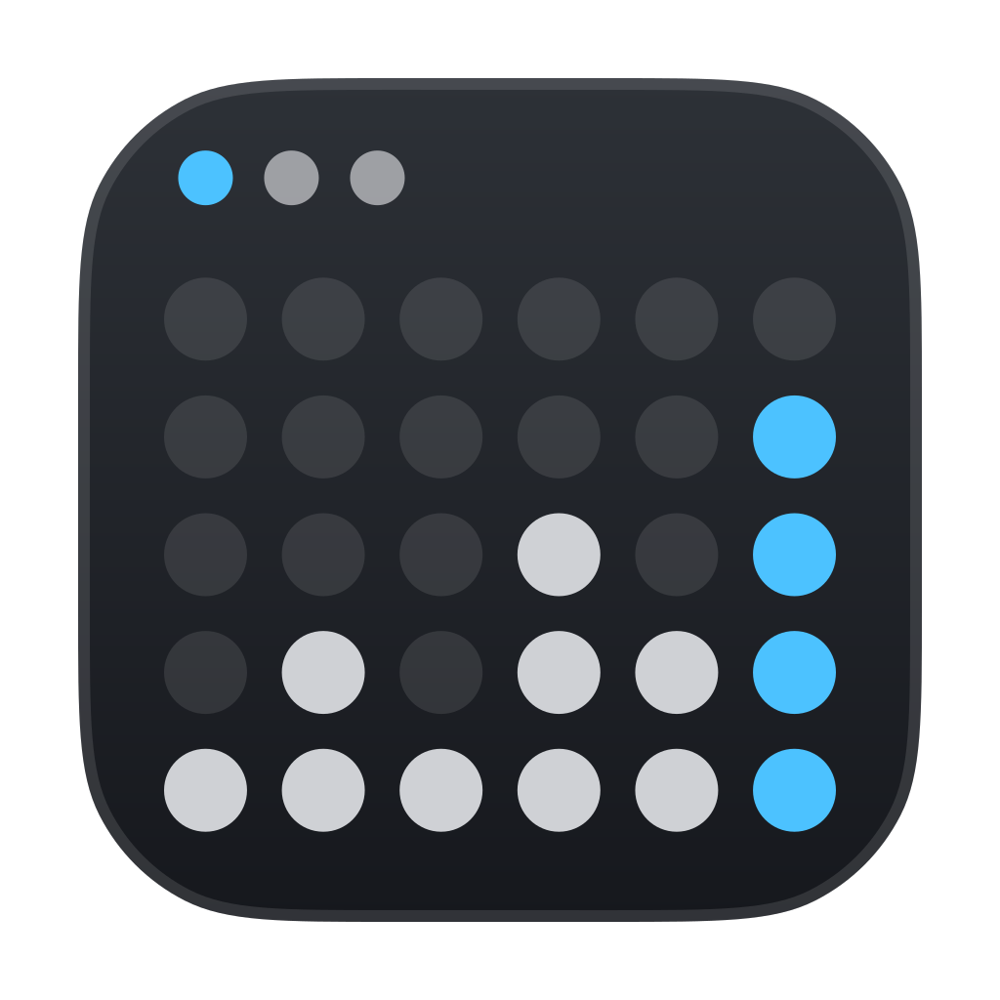
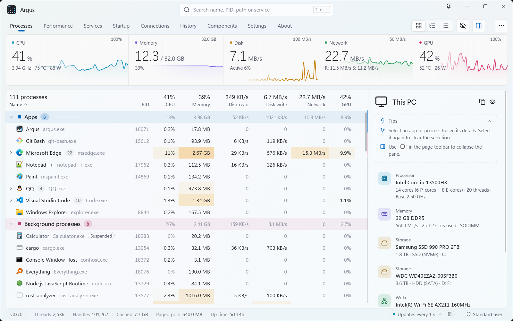

<div align="center">



# Argus

**빠르고 현대적이며 다양한 정보를 한눈에 보여 주는 Windows 작업 관리자**

[简体中文](README.md) · [繁體中文](README.zh-TW.md) · [English](README.en.md) · [Español](README.es.md) · [Deutsch](README.de.md) · [日本語](README.ja.md) · **한국어** · [Français](README.fr.md) · [Русский](README.ru.md)

[](https://argustask.com/ko/)

[공식 웹 사이트](https://argustask.com/ko/)에서 설치 없이 브라우저로 인터페이스를 직접 조작하고 기능 둘러보기를 체험할 수 있습니다.

[](https://github.com/Ray-lea/Argus/releases)
[](https://github.com/Ray-lea/Argus/releases)
[&color=0078D4)](#system-requirements)
[](LICENSE)

<a href="https://trendshift.io/repositories/310031?utm_source=trendshift-badge&amp;utm_medium=badge&amp;utm_campaign=badge-trendshift-310031" target="_blank" rel="noopener noreferrer"></a>
<a href="https://trendshift.io/repositories/310031?utm_source=trendshift-badge&amp;utm_medium=badge&amp;utm_campaign=badge-trendshift-310031" target="_blank" rel="noopener noreferrer"></a>

[주요 기능](#features) · [다운로드](#download) · [소스에서 빌드](#build-from-source) · [바로 가기 키](#keyboard-shortcuts) · [문서](#documentation) · [커뮤니티](#community)

</div>

<br>

<picture>
  <source media="(prefers-color-scheme: dark)" srcset="docs/images/screenshot-en-dark.png">
  
</picture>

<sub>미리 보기 이미지는 영어 인터페이스입니다.</sub>

<br>

Argus는 Rust에서 Windows 네이티브 API를 직접 호출하고 GPUI Kit 네이티브 구성 요소로 인터페이스를 그립니다. 그래프 곡선은 디스플레이 주사율에 맞춰 끊김 없이 흐릅니다. 프로젝트 이름은 그리스 신화에 등장하는 눈이 백 개 달린 거인 아르고스 판옵테스(Argus Panoptes)에서 따왔습니다.

<a id="star-history"></a>

## ⭐ Star 추이

일상적인 작업에 Argus가 도움이 된다면 GitHub에서 Star를 눌러 응원해 주세요. 프로젝트를 직접 후원하고 더 많은 사용자에게 알리는 데 큰 도움이 됩니다.

<a href="https://www.star-history.com/#Ray-lea/Argus&Date">
  <picture>
    <source media="(prefers-color-scheme: dark)" srcset="https://api.star-history.com/svg?repos=Ray-lea/Argus&type=Date&theme=dark">
    
  </picture>
</a>

<a id="features"></a>

## ✨ 주요 기능

<table>
<tr>
<td width="50%" valign="top"><picture><source media="(prefers-color-scheme: dark)" srcset="docs/images/features/processes-ko-dark.svg"></picture><br><b>프로세스</b>: 앱별, 프로세스 트리 또는 목록으로 보기, 검색·정렬 및 프로세스 트리 전체 끝내기 지원</td>
<td width="50%" valign="top"><picture><source media="(prefers-color-scheme: dark)" srcset="docs/images/features/performance-ko-dark.svg"></picture><br><b>성능</b>: CPU 코어별 부하, 클럭, 온도, 소비 전력과 메모리, 디스크, 네트워크, GPU 모니터링</td>
</tr>
<tr>
<td width="50%" valign="top"><picture><source media="(prefers-color-scheme: dark)" srcset="docs/images/features/history-ko-dark.svg"></picture><br><b>기록 조회</b>: 시간 범위를 고른 뒤 그래프의 원하는 시점을 클릭해 당시 리소스를 가장 많이 사용한 프로세스 확인</td>
<td width="50%" valign="top"><picture><source media="(prefers-color-scheme: dark)" srcset="docs/images/features/files-ko-dark.svg"></picture><br><b>파일 사용 확인</b>: 파일이나 폴더를 창에 끌어다 놓아 해당 경로를 사용 중인 프로세스 조회</td>
</tr>
<tr>
<td width="50%" valign="top"><picture><source media="(prefers-color-scheme: dark)" srcset="docs/images/features/rules-ko-dark.svg"></picture><br><b>바로 가기 메뉴</b>: 우선 순위 설정, 효율성 모드 켜기, 시작할 때마다 자동 적용되는 규칙 추가</td>
<td width="50%" valign="top"><picture><source media="(prefers-color-scheme: dark)" srcset="docs/images/features/ports-ko-dark.svg"></picture><br><b>연결 및 포트</b>: 포트 번호로 연결과 소유 프로세스를 찾고 바로 연결 끊기</td>
</tr>
</table>

<table>
<tr>
<td width="50%" valign="top"><b>서비스 및 시작 프로그램</b><br>서비스 시작·중지·삭제 및 시작 유형 변경, 시작 프로그램 사용·사용 안 함·삭제</td>
<td width="50%" valign="top"><b>시스템 트레이 및 모니터</b><br>트레이 아이콘에 실시간 CPU 사용률을 표시하고 데스크톱·작업 표시줄 모니터에 측정값을 상시 표시. <kbd>Ctrl</kbd>+<kbd>Alt</kbd>+<kbd>Esc</kbd>로 언제든 창 표시·숨기기</td>
</tr>
<tr>
<td width="50%" valign="top"><b>작업 관리자 대체</b><br><a href="docs/architecture/task-manager.md">Windows 작업 관리자 대체</a>(문서는 중국어) 후 <kbd>Ctrl</kbd>+<kbd>Shift</kbd>+<kbd>Esc</kbd>로 열기, 새 작업 실행 및 Windows 탐색기 다시 시작</td>
<td width="50%" valign="top"><b>모양 및 언어</b><br>Mica 배경, 시스템 강조색과 밝은·어두운 테마 연동, 9개 인터페이스 언어 지원</td>
</tr>
<tr>
<td width="50%" valign="top"><b>앱 내 업데이트</b><br>안정 버전과 베타 채널, 백그라운드 다운로드, 앱 내 업데이트 내역 확인</td>
<td width="50%" valign="top"><b>권한</b><br>표준 사용자 권한으로 모든 프로세스 확인 가능, 특권 서비스와 관리자 권한 실행은 선택 사항</td>
</tr>
</table>

<sub>README의 공간과 이미지 형식 제약으로 인해 위 데모는 프로그램 화면을 바탕으로 단순화해 다시 그린 예시이며, 표시된 프로세스와 데이터는 참고용 가상 값입니다. 실제 화면과 기능은 프로그램을 기준으로 합니다.</sub>

<a id="download"></a>

## 📦 다운로드

최신 안정 버전과 SHA-256 체크섬은 [공식 다운로드 페이지](https://argustask.com/ko/download/)에서 받을 수 있습니다. 모든 버전은 [GitHub Releases](https://github.com/Ray-lea/Argus/releases)에 있습니다.

| 파일 | 설명 |
| --- | --- |
| `Argus_<version>_x64-setup.exe` / `Argus_<version>_arm64-setup.exe` | **설치 버전(권장).** 모든 사용자를 위해 `Program Files`에 설치하며, 설치와 업데이트에 관리자 권한 승인이 필요합니다. 앱 내 업데이트를 지원합니다. |
| `Argus_<version>_x64.exe` / `Argus_<version>_arm64.exe` | **포터블 버전.** 단일 실행 파일로 바로 실행하며 설치 버전과 설정 및 기록을 공유합니다. 자동 업데이트는 지원하지 않습니다. |
| `SHA256SUMS.txt` | 배포 파일의 SHA-256 체크섬. |

[코드 서명 정책](#code-signing-policy) · [개인정보 처리방침(영어)](PRIVACY.md#english)

<a id="system-requirements"></a>

## 💻 시스템 요구 사항

- **운영 체제**: Windows 10 22H2(빌드 19045) 이상 및 Windows 11, x64 및 ARM64 아키텍처 지원
- **그래픽**: DirectX 11을 지원하는 그래픽 장치 및 드라이버

검증된 Windows 버전, 기능 차이와 권한 요구 사항은 [호환 범위](docs/guide/hardware-data.md#系统兼容范围)(중국어)를 참고하세요.

<a id="build-from-source"></a>

## 🔧 소스에서 빌드

빌드 전 준비할 환경:

- Rust `stable-x86_64-pc-windows-msvc` 또는 `stable-aarch64-pc-windows-msvc` 툴체인(1.100.0 이상)
- Node.js 26.13.1 이상의 26.x(또는 24.22.3 이상의 24.x LTS) 및 pnpm 12.18.0
- Visual Studio Build Tools(‘C++를 사용한 데스크톱 개발’ 워크로드 선택)

저장소 루트 디렉터리에서 PowerShell로 실행합니다.

```powershell
.\start.bat           # 개발 모드: Rust와 리소스 변경 시 자동 빌드·재시작, 빌드 실패 시 기존 인스턴스 유지
.\start.bat build     # 릴리스 빌드: target\release\argus.exe 생성
```

코드 검사, 설치 프로그램 패키징, 캐시 정리 등 자세한 명령은 [개발 가이드](docs/development/README.md)(중국어)를 참고하세요.

<a id="keyboard-shortcuts"></a>

## 🔑 바로 가기 키

| 작업 | 키 |
| --- | --- |
| 페이지 전환 | <kbd>Ctrl</kbd>+<kbd>1</kbd> … <kbd>Ctrl</kbd>+<kbd>9</kbd> |
| 다음 / 이전 페이지 | <kbd>Ctrl</kbd>+<kbd>Tab</kbd> / <kbd>Ctrl</kbd>+<kbd>Shift</kbd>+<kbd>Tab</kbd> |
| 프로세스 검색 | <kbd>Ctrl</kbd>+<kbd>F</kbd> |
| 새로 고침 일시 중지 | <kbd>Ctrl</kbd> 키를 누르는 동안 일시 중지, 떼면 재개(프로세스·성능 페이지) |
| 세부 정보 열기 | <kbd>Enter</kbd> |
| 작업 끝내기 | <kbd>Alt</kbd>+<kbd>E</kbd> 또는 <kbd>Delete</kbd>(<kbd>Shift</kbd>+<kbd>Delete</kbd>는 확인 생략) |
| 창 표시 또는 숨기기(전역) | <kbd>Ctrl</kbd>+<kbd>Alt</kbd>+<kbd>Esc</kbd> |

전체 목록은 **설정 → 바로 가기 키 → 바로 가기 키 보기**에서 확인할 수 있으며, 자세한 조작 방법은 [사용 가이드](docs/guide/README.md)(중국어)를 참고하세요.

<a id="documentation"></a>

## 📚 문서

상세 문서는 중국어로 작성되어 있으며, [온라인 문서](https://argustask.com/docs/)에서 안정 버전과 개발 버전 문서를 볼 수 있습니다.

| 문서 | 내용 요약 |
| --- | --- |
| [시작하기](docs/start/quick-start.md) | 빠른 시작, Argus 소개, 설치 및 업데이트, Windows 작업 관리자와의 비교 |
| [사용 가이드](docs/guide/README.md) | 화면과 조작, 트레이 상주와 바로 가기 키, 설정 안내, 하드웨어 데이터 출처와 제한 |
| [개발 가이드](docs/development/README.md) | 개발 환경과 명령, 빌드와 캐시 구조, 성능 기준선과 측정 방법 |
| [아키텍처](docs/architecture/README.md) | 시스템 계층과 데이터 흐름, 기술 스택 선택, 모듈별 역할 |
| [디자인](docs/design/README.md) | 디자인 원칙, 그래프 애니메이션 구현, 창 모양과 재질 |
| [알려진 문제](docs/known-issues.md) | 현재 버전의 알려진 제한 사항 |
| [업데이트 기록](changelog/ko-KR.md) | 버전별 상세 변경 사항 |

<a id="community"></a>

## 💬 커뮤니티

[](https://qm.qq.com/q/97YqJAQRNK) [](https://t.me/argustask)

중국어 QQ 그룹에서 문제를 제보하거나 기능을 제안하고 사용 경험을 나눌 수 있으며, Telegram 채널에서 새 버전과 프로젝트 소식을 받아 볼 수 있습니다. 앱 안의 **앱 정보 → QQ 그룹 참여** 또는 **앱 정보 → 채널 참여**에서도 열 수 있습니다.

<a id="contributing"></a>

## 🤝 기여하기

이슈 제보와 Pull Request를 환영합니다. 참여하기 전에 [기여 가이드](.github/CONTRIBUTING.md)(중국어)를 먼저 읽어 주세요. 보안 취약점은 [보안 정책](.github/SECURITY.md)(중국어)에 따라 비공개로 제보해 주세요.

<a id="roadmap"></a>

## 🧭 로드맵

완료된 마일스톤과 전체 계획은 [로드맵](docs/roadmap.md)(중국어)에 정리되어 있습니다. 현재 진행 중이거나 계획된 주요 작업은 다음과 같습니다.

- [ ] **하드웨어 센서 확장**: 공식 PawnIO 드라이버를 바탕으로 일반 소비자용 하드웨어의 센서 지원 범위 확대([현재 지원 범위](docs/guide/hardware-data.md)(중국어) 참고)
- [ ] **바로 가기 키 확장**: 왼쪽·오른쪽 보조 키 구분, 보조 키만으로 이루어진 조합 또는 일반 키 두 개 조합 지원

<a id="code-signing-policy"></a>

## 🔐 코드 서명 정책 (Code signing policy)

무료 코드 서명 서비스는 [SignPath.io](https://about.signpath.io/)에서, 코드 서명 인증서는 [SignPath Foundation](https://signpath.org/)에서 제공합니다.

Free code signing provided by [SignPath.io](https://about.signpath.io/), certificate by [SignPath Foundation](https://signpath.org/).

테스트 서명은 연동되어 있으며, 현재 정식 릴리스는 Windows Authenticode 서명 없이 배포됩니다. 정식 서명이 활성화된 뒤에는 이 저장소 소스에서 GitHub Actions로 빌드하는 Argus 기본 프로그램, 작업 관리자 보조 프로그램, 제거 프로그램, 설치 프로그램이 서명 대상이 되며, 함께 포함되는 타사 프로그램은 원래 서명을 유지합니다.

- **코드 관리 및 리뷰(Committers and reviewers)**: [@Ray-lea](https://github.com/Ray-lea), 코드 유지 보수와 외부 기여 리뷰를 담당합니다.
- **서명 승인(Approvers)**: [@Ray-lea](https://github.com/Ray-lea), 모든 정식 서명 요청을 직접 검토하고 승인합니다.
- **개인정보 처리방침(Privacy policy)**: [English](PRIVACY.md#english) · [简体中文](PRIVACY.md#简体中文). 기본으로 켜져 있는 업데이트 확인, 프록시 대체 연결, 필요 시 PawnIO 다운로드, 사용자 피드백 제출 및 타사 서비스의 데이터 처리를 설명합니다.

앱 내 업데이트는 별도의 Minisign 배포 키로 설치 패키지와 버전 번호를 검증하며, Windows Authenticode는 실행 파일의 서명자를 확인하는 데 사용됩니다.

<a id="acknowledgements"></a>

## 🙏 감사의 글

Argus는 다음 오픈 소스 프로젝트를 바탕으로 만들어졌습니다.

| 프로젝트 | 용도 |
| --- | --- |
| [GPUI Kit](https://gpui-kit.com/) | 네이티브 데스크톱 구성 요소, 창, 표, 그래프 |
| [windows-rs](https://github.com/microsoft/windows-rs) | Windows 네이티브 API용 Rust 바인딩 |
| [Biome](https://biomejs.dev/), [NSIS](https://nsis.sourceforge.io/) | 개발 검사 및 Windows 패키징 |
| [serde](https://serde.rs/), [reqwest](https://github.com/seanmonstar/reqwest) 등 Rust crate | 직렬화, 네트워크 요청 등 기반 기능 |
| [PawnIO](https://pawnio.eu/), [PawnIO.Modules](https://github.com/namazso/PawnIO.Modules) | 선택 사항인 커널 센서에 사용하는 서명된 드라이버와 수집 모듈 |
| [ZenStates-Core](https://github.com/irusanov/ZenStates-Core), [LibreHardwareMonitor](https://github.com/LibreHardwareMonitor/LibreHardwareMonitor), [GNR-SMU](https://github.com/Kyworn/gnr-smu) | AMD SMU 테이블 등 CPU 레지스터 구조 참고 자료 |
| [Intel IGCL](https://github.com/intel/drivers.gpu.control-library), [AMD ADL](https://github.com/GPUOpen-LibrariesAndSDKs/display-library) | GPU 텔레메트리 인터페이스 |

모든 타사 구성 요소와 라이선스 고지는 [THIRD-PARTY-NOTICES.txt](THIRD-PARTY-NOTICES.txt)에 있습니다.

[LINUX DO](https://linux.do/) 커뮤니티의 지원에 감사드립니다.

<!-- supporters:start · node scripts/supporters.mjs -->
<p align="center">
  <a href="https://github.com/bronyaicu" target="_blank" rel="noopener"><picture><source media="(prefers-color-scheme: dark)" srcset="docs/images/supporters/bronyaicu-ko-dark.svg"></picture></a>
</p>
<!-- supporters:end -->

<a id="license"></a>

## 📄 라이선스

Argus는 자유 소프트웨어이며, [GNU Affero General Public License](LICENSE) 제3판 또는 이후 버전(`AGPL-3.0-or-later`)에 따라 배포됩니다.

<a href="https://next.ossinsight.io/widgets/official/compose-recent-active-contributors?repo_id=1415551131&limit=30" target="_blank" style="display: block" align="center">
  <picture>
    <source media="(prefers-color-scheme: dark)" srcset="https://next.ossinsight.io/widgets/official/compose-recent-active-contributors/thumbnail.png?repo_id=1415551131&limit=30&image_size=auto&color_scheme=dark" width="655" height="auto">
    
  </picture>
</a>

<!-- Made with [OSS Insight](https://ossinsight.io/) -->

<div align="center">
<br>
<sub>Argus · Windows 작업 관리자 · © 2026 Argus contributors</sub>
</div>
