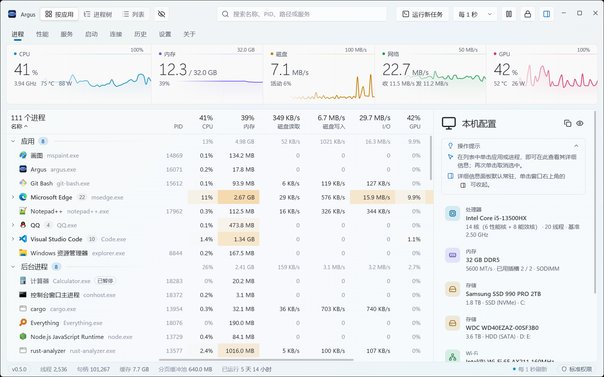

<div align="center">


# Argus

**快速、现代、信息丰富的 Windows 任务管理器**

**简体中文** · [繁體中文](README.zh-TW.md) · [English](README.en.md) · [Español](README.es.md) · [Deutsch](README.de.md) · [日本語](README.ja.md) · [Français](README.fr.md) · [Русский](README.ru.md)

[](https://argustask.com/)

在[官方网站](https://argustask.com/)可直接在浏览器中交互体验完整界面与功能导览，无需下载安装

[](https://github.com/Ray-lea/Argus/releases)
[](https://github.com/Ray-lea/Argus/releases)
[](#-系统要求)
[](LICENSE)

[特性](#-特性) · [下载](#-下载) · [从源码构建](#-从源码构建) · [快捷键](#-快捷键) · [文档](#-文档) · [交流与反馈](#-交流与反馈)

</div>

<br>

<picture>
  <source media="(prefers-color-scheme: dark)" srcset="docs/images/screenshot-dark.png">
  
</picture>

<br>

Argus 采用 Rust 直接调用 Windows 原生接口，基于 GPUI Kit 原生组件构建界面，图表曲线随屏幕刷新率连续流动。项目名称取自希腊神话中的百眼巨人阿尔戈斯（Argus Panoptes）。

## ⭐ Star 趋势

如果 Argus 对日常使用有所帮助，欢迎在 GitHub 上点亮 Star。这是对项目最直接的支持，也能让更多人发现它。

<a href="https://www.star-history.com/#Ray-lea/Argus&Date">
  <picture>
    <source media="(prefers-color-scheme: dark)" srcset="https://api.star-history.com/svg?repos=Ray-lea/Argus&type=Date&theme=dark">
    
  </picture>
</a>

## ✨ 特性

| | 功能 | 说明 |
|:---:|---|---|
| 🧮 | **进程** | 支持按应用、进程树或列表三种视图浏览，实时呈现各进程的 CPU、内存、磁盘读写、网络流量与 GPU 占用。支持排序、搜索、结束进程或整个进程树；详细信息面板展示命令行、所属用户与完整性级别等。 |
| ⚡ | **优先级与效率模式** | 可通过右键菜单即时调整，也可建立规则，在目标程序每次启动时自动应用。 |
| 📈 | **性能** | 全方位监控 CPU（每核心、性能核与能效核、频率、温度、功耗）、内存、磁盘（含健康状况与 SMART 属性）、网络、GPU 与电池状态。 |
| 🧩 | **服务与启动项** | 启动、停止服务及修改启动类型；启用或禁用开机启动项，状态与系统任务管理器保持同步。 |
| 🌐 | **连接与端口** | 列出活动的 TCP 与 UDP 端点及其所属进程，支持按端口精确搜索与断开连接。 |
| 🔍 | **文件占用** | 将文件或文件夹拖放到窗口即可定位占用进程，结合 Restart Manager 与句柄枚举（涵盖进程当前工作目录）进行排查。 |
| 🕘 | **历史回溯** | 自动记录最近 7 天的资源占用曲线，单击任意时刻即可回看当时最繁忙的进程。 |
| 📌 | **常驻托盘** | 支持通过全局快捷键随时显示或隐藏窗口；隐藏时资源开销极低，最小化与后台常驻时的刷新间隔可分别设置。 |
| 🔄 | **应用内更新** | 提供稳定版与测试版双通道，新版本在后台静默下载并于标题栏提示，更新前后均可查看版本变更说明；下载默认依次连接 GitHub、官方镜像与加速代理，可在设置中调整。 |
| 🎨 | **原生外观** | Windows 11 22H2 及以上采用 Mica 云母材质，Windows 11 21H2 与 Windows 10 使用实色背景；系统强调色及浅色、深色主题默认跟随系统，也可在设置中单独指定。 |
| 🌍 | **多语言** | 支持简体中文、繁体中文、英文、西班牙文、德文、日文、法文和俄文，默认跟随 Windows 显示语言；提供首次启动引导，协助完成常用设置。 |
| 👤 | **无需管理员权限** | 在标准权限下即可完整查看全部进程的路径与各项资源占用。 |
| 🔐 | **可选管理员运行** | 在设置或首次启动引导中完成一次授权后，登录启动、快捷方式和任务管理器入口即可统一以管理员身份运行，且可随时关闭。 |
| 🛡️ | **可选特权服务** | 经一次管理员授权安装后，即使界面保持标准权限运行，也能管理系统进程、检查高权限进程的文件占用、自动应用规则、控制服务与断开连接，并统计每进程网络流量（在 Windows 10 及 Windows 11 24H2 之前的版本上亦包括磁盘读写）；可在设置中随时卸载。 |
| 🪟 | **任务与系统集成** | 支持[替换系统默认任务管理器](docs/architecture/task-manager.md)，从任意页面运行新任务（可选管理员权限），或重新启动当前桌面的 Windows 资源管理器。 |

## 📦 下载

在[官网下载页](https://argustask.com/download/)获取最新稳定版和 SHA-256 校验值。全部版本见 [GitHub Releases](https://github.com/Ray-lea/Argus/releases)。

| 文件 | 说明 |
|---|---|
| `Argus_<版本>_x64-setup.exe` | **安装版（推荐）**。为所有用户安装至 `Program Files`，安装与更新需管理员授权，支持应用内更新。 |
| `Argus_<版本>_x64.exe` | **免安装版**。单文件直接运行，与安装版共用设置与历史数据，不支持自动更新。 |
| `SHA256SUMS.txt` | 上述发布文件的 SHA-256 校验值。 |

[代码签名策略（Code signing policy）](#code-signing-policy) · [隐私策略](PRIVACY.md#简体中文)

## 💻 系统要求

- **操作系统**：Windows 10 22H2（内部版本 19045）及以上版本（含 Windows 11），仅支持 x64 架构
- **图形**：支持 DirectX 11 的图形设备与驱动

已验证的系统版本、功能差异与权限要求详见[兼容范围](docs/guide/hardware-data.md#系统兼容范围)。

## 🔧 从源码构建

构建前需准备以下环境：

- Rust `stable-x86_64-pc-windows-msvc` 工具链（1.99.1 及以上）
- Node.js 26.12.1 及以上的 26.x 版本（亦支持 24.22.1 及以上的 24.x LTS）与 pnpm 12.14.0
- Visual Studio Build Tools（勾选“使用 C++ 的桌面开发”工作负载）

在仓库根目录下使用 PowerShell 运行：

```powershell
.\start.bat           # 开发模式：Rust 与资源文件修改后自动编译并重启，编译失败时保留当前实例
.\start.bat build     # 发布构建：生成 target\release\argus.exe
```

代码检查、打包安装程序与清理缓存等更多命令，请参阅[开发指南](docs/development/README.md)。

## 🔑 快捷键

| 操作 | 按键 |
|---|---|
| 切换页面 | <kbd>Ctrl</kbd>+<kbd>1</kbd> … <kbd>Ctrl</kbd>+<kbd>8</kbd> |
| 搜索进程 | <kbd>Ctrl</kbd>+<kbd>F</kbd> |
| 临时暂停刷新 | 按住 <kbd>Ctrl</kbd>，松开后恢复（进程页、性能页） |
| 打开详细信息 | <kbd>Enter</kbd> |
| 结束进程 | <kbd>Alt</kbd>+<kbd>E</kbd> 或 <kbd>Delete</kbd>（<kbd>Shift</kbd>+<kbd>Delete</kbd> 跳过确认） |
| 显示或隐藏窗口（全局） | <kbd>Ctrl</kbd>+<kbd>Alt</kbd>+<kbd>Esc</kbd> |

完整按键列表可在“设置 → 快捷键 → 查看快捷键”中查看，更多操作说明请参阅[使用指南](docs/guide/README.md)。

## 📚 文档

除仓库内文档外，亦可浏览[在线文档](https://argustask.com/docs/)（含稳定版与开发版）。

| 文档 | 内容概览 |
|---|---|
| [使用指南](docs/guide/README.md) | 界面与操作、后台常驻与快捷键、设置说明、硬件数据的来源与限制 |
| [开发指南](docs/development/README.md) | 开发环境与命令、构建与缓存机制、性能基线与测量方法 |
| [架构](docs/architecture/README.md) | 系统分层与数据流、技术栈选型、各模块职责 |
| [设计](docs/design/README.md) | 设计原则、曲线动画实现、窗口外观与材质 |
| [已知问题](docs/known-issues.md) | 当前版本的已知限制 |
| [更新日志](changelog/zh-CN.md) | 历次版本的详细变更 |

## 💬 交流与反馈

[](https://qm.qq.com/q/97YqJAQRNK)

欢迎加群反馈问题、提出建议或交流使用心得，也可通过应用内“关于 → 加入 QQ 群”打开加群页面。

## 🤝 参与贡献

欢迎提交问题与拉取请求，参与前请先阅读[贡献指南](.github/CONTRIBUTING.md)。安全漏洞请按[安全策略](.github/SECURITY.md)私下报告。

## 🧭 路线图

已完成里程碑与完整规划参见[路线图](docs/roadmap.md)，当前推进与计划中的工作包括：

- [ ] **硬件传感器扩展**：基于官方 PawnIO 驱动持续扩大消费级硬件的传感器覆盖范围（当前支持见[硬件支持范围](docs/guide/hardware-data.md)）
- [ ] **快捷键扩展**：区分左右修饰键，支持仅由修饰键或两个普通键组成的组合

<a id="code-signing-policy"></a>

## 🔐 代码签名策略（Code signing policy）

免费代码签名服务由 [SignPath.io](https://about.signpath.io/) 提供，代码签名证书由 [SignPath Foundation](https://signpath.org/) 提供。

Free code signing provided by [SignPath.io](https://about.signpath.io/), certificate by [SignPath Foundation](https://signpath.org/).

当前已接入测试签名，正式发布仍使用未签署 Windows Authenticode 的文件。正式签名启用后，签名范围为本仓库源码经 GitHub Actions 构建的 Argus 主程序、任务管理器辅助程序、卸载程序与安装程序；随附的第三方程序保留其原有签名。

- **代码提交与审查（Committers and reviewers）**：[@Ray-lea](https://github.com/Ray-lea)，负责维护代码及审查外部贡献。
- **签名审批（Approvers）**：[@Ray-lea](https://github.com/Ray-lea)，负责人工批准每个正式签名请求。
- **隐私策略（Privacy policy）**：[简体中文](PRIVACY.md#简体中文) · [English](PRIVACY.md#english)。说明默认开启的更新检查、代理回退、按需下载 PawnIO、主动反馈及第三方服务的数据处理。

应用内更新使用独立的 Minisign 发布密钥校验安装包与版本号；Windows Authenticode 用于验证可执行文件的签名者。

## 🙏 致谢

Argus 构建于以下开源项目之上，谨致谢忱：

| 项目 | 用途 |
|---|---|
| [GPUI Kit](https://gpui-kit.com/) | 原生桌面组件、窗口、表格与曲线 |
| [windows-rs](https://github.com/microsoft/windows-rs) | Windows 原生接口的 Rust 绑定 |
| [Biome](https://biomejs.dev/)、[NSIS](https://nsis.sourceforge.io/) | 开发检查与 Windows 打包 |
| [serde](https://serde.rs/)、[reqwest](https://github.com/seanmonstar/reqwest) 等 Rust crate | 序列化、网络请求等基础功能 |
| [PawnIO](https://pawnio.eu/)、[PawnIO.Modules](https://github.com/namazso/PawnIO.Modules) | 可选内核传感器所用的签名驱动与采集模块 |
| [ZenStates-Core](https://github.com/irusanov/ZenStates-Core)、[LibreHardwareMonitor](https://github.com/LibreHardwareMonitor/LibreHardwareMonitor)、[GNR-SMU](https://github.com/Kyworn/gnr-smu) | AMD SMU 表等 CPU 寄存器布局参考 |
| [Intel IGCL](https://github.com/intel/drivers.gpu.control-library)、[AMD ADL](https://github.com/GPUOpen-LibrariesAndSDKs/display-library) | 显卡遥测接口 |

全部第三方组件及其许可证声明见 [THIRD-PARTY-NOTICES.txt](THIRD-PARTY-NOTICES.txt)。

感谢 [LINUX DO](https://linux.do/) 社区的支持。

## 📄 许可证

Argus 是自由软件，依据 [GNU Affero General Public License](LICENSE) 第 3 版或任何更高版本（`AGPL-3.0-or-later`）发布。

<a href="https://next.ossinsight.io/widgets/official/compose-recent-active-contributors?repo_id=1415551131&limit=30" target="_blank" style="display: block" align="center">
  <picture>
    <source media="(prefers-color-scheme: dark)" srcset="https://next.ossinsight.io/widgets/official/compose-recent-active-contributors/thumbnail.png?repo_id=1415551131&limit=30&image_size=auto&color_scheme=dark" width="655" height="auto">
    
  </picture>
</a>

<!-- Made with [OSS Insight](https://ossinsight.io/) -->

<div align="center">
<br>
<sub>Argus · Windows 任务管理器 · © 2026 Argus contributors</sub>
</div>
