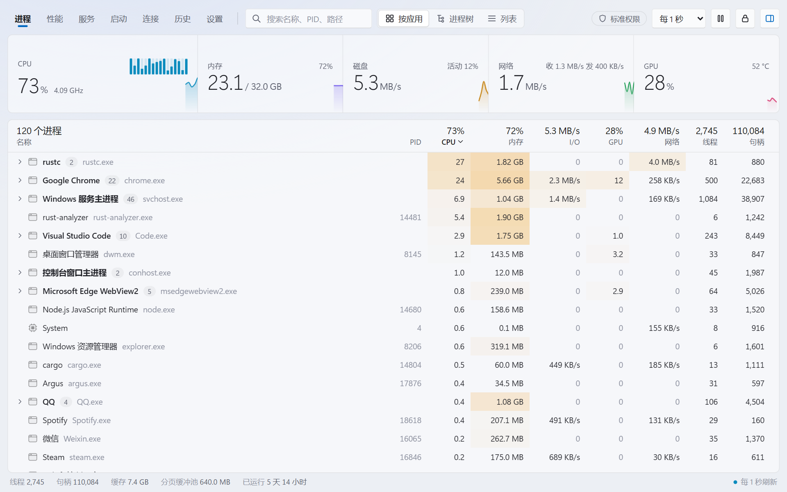

<div align="center">


# Argus

**快速、现代、信息丰富的 Windows 任务管理器**

**简体中文** · [English](README.en.md)

[](https://github.com/Ray-lea/Argus/releases)
[](https://github.com/Ray-lea/Argus/releases)
[](#-系统要求)
[](LICENSE)

[](https://www.rust-lang.org/)
[](https://tauri.app/)
[](https://www.solidjs.com/)
[](https://www.typescriptlang.org/)

[特性](#-特性) · [下载](#-下载) · [从源码构建](#-从源码构建) · [快捷键](#-快捷键) · [文档](#-文档)

</div>

<br>

<picture>
  <source media="(prefers-color-scheme: dark)" srcset="docs/images/screenshot-dark.png">
  
</picture>

<br>

Argus 通过 Rust 直接读取 Windows 原生接口，以 Tauri 2 与 SolidJS 构建界面。进程、性能、服务、启动项、网络连接以及最近 7 天的历史记录集中在同一窗口中，曲线随屏幕刷新率连续流动；常驻托盘时约占用单个 CPU 核心的 1%。名称取自希腊神话中的百眼巨人阿尔戈斯（Argus Panoptes）。

## ✨ 特性

| | 功能 | 说明 |
|:---:|---|---|
| 🧮 | **进程** | 按应用、进程树或列表查看，包括每个进程的 GPU 占用；启用特权服务或以管理员身份运行时另含网络流量。支持排序、搜索、结束进程或整个进程树；详细信息面板显示命令行、用户、完整性级别等。 |
| ⚡ | **优先级与效率模式** | 通过右键菜单设置，也可建立规则，在程序每次启动时自动应用。 |
| 📈 | **性能** | CPU（每核心、性能核与能效核、频率、温度、功耗）、内存、磁盘、网络、GPU 与电池。 |
| 🧩 | **服务与启动项** | 启动、停止服务及修改启动类型；启用或禁用启动项，与系统任务管理器使用同一开关。 |
| 🌐 | **连接与端口** | TCP 与 UDP 端点及其所属进程，支持按端口精确搜索和断开连接。 |
| 🔍 | **文件占用** | 将文件或文件夹拖放到窗口，结合 Restart Manager 与句柄枚举查找占用进程，包括进程的当前目录；借助特权服务可检查更多进程。 |
| 🕘 | **历史回溯** | 最近 7 天的资源曲线，单击任意时刻即可查看当时占用最高的进程。 |
| 📌 | **常驻托盘** | 通过全局快捷键 Ctrl+Alt+Esc 显示或隐藏窗口；隐藏时资源占用极低。 |
| 🔄 | **应用内更新** | 提供稳定版与测试版两个通道，可选 GitHub 加速代理；仅安装通过签名校验的版本。 |
| 🎨 | **原生外观** | Mica 背景与系统强调色，深色、浅色主题默认跟随系统，也可在设置中指定。 |
| 🌍 | **多语言** | 简体中文与英文界面，默认跟随 Windows 显示语言；首次启动时引导完成常用设置。 |
| 👤 | **无需管理员权限** | 以标准用户身份即可查看全部进程的路径与资源占用。 |
| 🛡️ | **可选特权服务** | 经一次管理员授权后，以标准权限运行的界面同样可以管理系统进程、自动应用规则、统计每进程网络流量、控制服务及断开连接；可在设置中卸载。 |

## 📦 下载

从 [GitHub Releases](https://github.com/Ray-lea/Argus/releases) 下载最新版本：

| 文件 | 说明 |
|---|---|
| `Argus_<版本>_x64-setup.exe` | **安装版（推荐）**。为所有用户安装到 Program Files，安装与更新需要管理员授权；支持应用内更新。 |
| `Argus_<版本>_x64.exe` | **免安装版**。直接运行，与安装版共用设置与数据，不支持自动更新。 |
| `SHA256SUMS.txt` | 上述文件的 SHA-256 校验值。 |

> [!NOTE]
> 程序尚未进行代码签名，首次运行时 Windows SmartScreen 可能提示“未知发布者”。

## 💻 系统要求

- Windows 11 x64
- WebView2 运行时（Windows 11 已内置）

## 🔧 从源码构建

需要 Rust（stable，MSVC 工具链）、Node.js 22 及以上版本、pnpm，以及 Visual Studio Build Tools（“使用 C++ 的桌面开发”）。在仓库根目录运行：

```bash
start.bat           # 开发模式：前端即时热更新，Rust 代码修改后自动重新编译并重启
start.bat build     # 发布构建，生成 target\release\argus.exe
```

浏览器预览、检查、打包安装程序和清理缓存等其他命令，参见[开发指南](docs/development/README.md)。

## 🔑 快捷键

| 操作 | 按键 |
|---|---|
| 切换页面 | <kbd>Ctrl</kbd>+<kbd>1</kbd> … <kbd>Ctrl</kbd>+<kbd>7</kbd> |
| 搜索进程 | <kbd>Ctrl</kbd>+<kbd>F</kbd> |
| 打开详细信息 | <kbd>Enter</kbd> |
| 结束进程 | <kbd>Delete</kbd>（<kbd>Shift</kbd>+<kbd>Delete</kbd> 跳过确认） |
| 显示或隐藏窗口（全局） | <kbd>Ctrl</kbd>+<kbd>Alt</kbd>+<kbd>Esc</kbd> |

完整的操作说明参见[使用指南](docs/guide/README.md)。

## 📚 文档

| 文档 | 内容 |
|---|---|
| [使用指南](docs/guide/README.md) | 界面与操作、常驻与快捷键、设置、硬件数据的来源与限制 |
| [开发指南](docs/development/README.md) | 环境与命令、构建与缓存、性能基线与测量 |
| [架构](docs/architecture/README.md) | 分层与数据流、各模块职责 |
| [设计](docs/design/README.md) | 设计原则、曲线动画、窗口外观 |
| [路线图](docs/roadmap.md) | 已完成与计划中的功能 |
| [已知问题](docs/known-issues.md) | 当前版本的限制 |
| [更新日志](CHANGELOG.md) | 各版本的变更 |

## 🤝 参与贡献

欢迎提交问题与拉取请求，请先阅读[贡献指南](.github/CONTRIBUTING.md)。安全漏洞请按[安全策略](.github/SECURITY.md)私下报告，不要创建公开的 Issue。

## 🧭 路线图

- [x] **M0–M3**：进程、性能、服务、启动项、网络连接与文件占用
- [x] **M4**：每进程 GPU 占用、优先级与效率模式规则、历史回溯
- [x] **M5**：可选特权服务、规则与网络采集接入、按句柄查询文件占用、[系统任务管理器替换](docs/architecture/task-manager.md)
- [ ] 系统任务管理器替换在真实管理员环境中的验收
- [ ] 依赖内核驱动的功能

详情参见[路线图](docs/roadmap.md)。

## 📄 许可证

Argus 是自由软件，依据 [GNU Affero General Public License](LICENSE) 第 3 版或任何更高版本（AGPL-3.0-or-later）发布。

<div align="center">
<br>
<sub>Argus · Windows 任务管理器 · © 2026 Argus contributors</sub>
</div>
