<div align="center">


# Argus

**Быстрый, современный и информативный диспетчер задач для Windows**

[简体中文](README.md) · [繁體中文](README.zh-TW.md) · [English](README.en.md) · [Español](README.es.md) · [Deutsch](README.de.md) · [日本語](README.ja.md) · [Français](README.fr.md) · **Русский**

[](https://argustask.com/ru/)

На [официальном сайте](https://argustask.com/ru/) можно опробовать интерактивный интерфейс и обзор функций прямо в браузере, без установки приложения.

[](https://github.com/Ray-lea/Argus/releases)
[](https://github.com/Ray-lea/Argus/releases)
[](#system-requirements)
[](LICENSE)

<a href="https://trendshift.io/repositories/310031?utm_source=trendshift-badge&amp;utm_medium=badge&amp;utm_campaign=badge-trendshift-310031" target="_blank" rel="noopener noreferrer"></a>
<a href="https://trendshift.io/repositories/310031?utm_source=trendshift-badge&amp;utm_medium=badge&amp;utm_campaign=badge-trendshift-310031" target="_blank" rel="noopener noreferrer"></a>

[Возможности](#features) · [Загрузка](#download) · [Сборка из исходников](#build-from-source) · [Сочетания клавиш](#keyboard-shortcuts) · [Документация](#documentation) · [Сообщество](#community)

</div>

<br>

<picture>
  <source media="(prefers-color-scheme: dark)" srcset="docs/images/screenshot-en-dark.png">
  
</picture>

<sub>На снимках показан английский интерфейс.</sub>

<br>

Argus обращается к нативным API Windows напрямую из Rust. Интерфейс построен на нативных компонентах GPUI Kit, а графики плавно движутся с частотой обновления экрана. Название проекта происходит от Аргуса Панопта — стоглазого великана древнегреческой мифологии.

<a id="star-history"></a>

## ⭐ Звёзды на GitHub

Если Argus полезен в повседневной работе, звезда на GitHub поможет поддержать проект и познакомить с ним других пользователей.

<a href="https://www.star-history.com/#Ray-lea/Argus&Date">
  <picture>
    <source media="(prefers-color-scheme: dark)" srcset="https://api.star-history.com/svg?repos=Ray-lea/Argus&type=Date&theme=dark">
    
  </picture>
</a>

<a id="features"></a>

## ✨ Возможности

<table>
<tr>
<td width="50%" valign="top"><picture><source media="(prefers-color-scheme: dark)" srcset="docs/images/features/processes-ru-dark.svg"></picture><br><b>Процессы</b>: по приложениям, деревом или списком; поиск, сортировка и завершение всего дерева</td>
<td width="50%" valign="top"><picture><source media="(prefers-color-scheme: dark)" srcset="docs/images/features/performance-ru-dark.svg"></picture><br><b>Производительность</b>: нагрузка по ядрам, частота, температура и мощность CPU, а также память, диски, сеть и GPU</td>
</tr>
<tr>
<td width="50%" valign="top"><picture><source media="(prefers-color-scheme: dark)" srcset="docs/images/features/history-ru-dark.svg"></picture><br><b>История</b>: щелчок по любому моменту на графиках за 7 дней показывает самые загруженные процессы в то время</td>
<td width="50%" valign="top"><picture><source media="(prefers-color-scheme: dark)" srcset="docs/images/features/files-ru-dark.svg"></picture><br><b>Занятые файлы</b>: перетащите файл или папку в окно, чтобы увидеть использующие их процессы</td>
</tr>
<tr>
<td width="50%" valign="top"><picture><source media="(prefers-color-scheme: dark)" srcset="docs/images/features/rules-ru-dark.svg"></picture><br><b>Контекстное меню</b>: задать приоритет, включить режим эффективности или добавить правило для каждого запуска</td>
<td width="50%" valign="top"><picture><source media="(prefers-color-scheme: dark)" srcset="docs/images/features/ports-ru-dark.svg"></picture><br><b>Подключения и порты</b>: поиск подключений и их процессов по порту и закрытие подключений</td>
</tr>
</table>

<table>
<tr>
<td width="50%" valign="top"><b>Службы и автозагрузка</b><br>Запуск и остановка служб, изменение типа запуска, включение и отключение автозагрузки</td>
<td width="50%" valign="top"><b>Область уведомлений</b><br><kbd>Ctrl</kbd>+<kbd>Alt</kbd>+<kbd>Esc</kbd> показывает и скрывает окно; в скрытом состоянии расход ресурсов минимален</td>
</tr>
<tr>
<td width="50%" valign="top"><b>Замена Диспетчера задач</b><br>Можно <a href="docs/architecture/task-manager.md">заменить Диспетчер задач Windows</a> —описание на китайском— и открывать Argus по <kbd>Ctrl</kbd>+<kbd>Shift</kbd>+<kbd>Esc</kbd>; запуск новых задач и перезапуск Проводника</td>
<td width="50%" valign="top"><b>Внешний вид и языки</b><br>Фон Mica, цвет акцента и светлая или тёмная тема по Windows; 8 языков интерфейса</td>
</tr>
<tr>
<td width="50%" valign="top"><b>Обновления в приложении</b><br>Стабильный и бета-каналы, загрузка в фоне, список изменений в приложении</td>
<td width="50%" valign="top"><b>Права</b><br>Все процессы видны с обычными правами; привилегированная служба и запуск от администратора необязательны</td>
</tr>
</table>

<sub>Из-за ограничений README по объёму и форматам изображений демонстрации выше — упрощённые перерисовки интерфейса Argus с примерными процессами и данными. Они приведены только для справки; ориентиром служит сама программа.</sub>

<a id="download"></a>

## 📦 Загрузка

Последняя стабильная версия и контрольные суммы SHA-256 доступны на [официальной странице загрузки](https://argustask.com/ru/download/). Все версии находятся в [GitHub Releases](https://github.com/Ray-lea/Argus/releases).

| Файл | Описание |
|---|---|
| `Argus_<version>_x64-setup.exe` | **Установщик, рекомендуется.** Устанавливает программу для всех пользователей в `Program Files`. Установка и обновления требуют разрешения администратора. Поддерживает обновления из приложения. |
| `Argus_<version>_x64.exe` | **Портативная версия.** Отдельный исполняемый файл с общими настройками и историей для портативной и установленной версий. Автоматическое обновление не поддерживается. |
| `SHA256SUMS.txt` | Контрольные суммы SHA-256 файлов выпуска. |

[Политика подписи кода](#code-signing-policy) · [Политика конфиденциальности на английском](PRIVACY.md#english)

<a id="system-requirements"></a>

## 💻 Системные требования

- **Операционная система**: Windows 10 22H2, сборка 19045, или новее, включая Windows 11; только x64.
- **Графика**: графическое устройство и драйвер с поддержкой DirectX 11.

Проверенные версии Windows, различия функций и требования к правам описаны в [документации по совместимости](docs/guide/hardware-data.md#系统兼容范围) на китайском.

<a id="build-from-source"></a>

## 🔧 Сборка из исходников

Необходимы:

- Набор инструментов Rust `stable-x86_64-pc-windows-msvc`, версия 1.100.0 или новее.
- Node.js 26.x начиная с 26.13.1 либо 24.x LTS начиная с 24.22.3, а также pnpm 12.18.0.
- Visual Studio Build Tools с рабочей нагрузкой «Разработка классических приложений на C++».

Выполнить в PowerShell из корня репозитория:

```powershell
.\start.bat           # Разработка: изменения Rust и ресурсов вызывают пересборку и перезапуск; при ошибке текущий экземпляр продолжает работать
.\start.bat build     # Сборка для распространения: создаёт target\release\argus.exe
```

Проверки кода, создание установщика и очистка кэшей описаны в [руководстве разработчика](docs/development/README.md) на китайском.

<a id="keyboard-shortcuts"></a>

## 🔑 Сочетания клавиш

| Действие | Клавиши |
|---|---|
| Переключить страницу | <kbd>Ctrl</kbd>+<kbd>1</kbd> … <kbd>Ctrl</kbd>+<kbd>8</kbd> |
| Найти процесс | <kbd>Ctrl</kbd>+<kbd>F</kbd> |
| Временно приостановить обновление | Удерживать <kbd>Ctrl</kbd>, отпустить для продолжения; страницы «Процессы» и «Производительность» |
| Открыть подробности | <kbd>Enter</kbd> |
| Снять задачу | <kbd>Alt</kbd>+<kbd>E</kbd> или <kbd>Delete</kbd>; <kbd>Shift</kbd>+<kbd>Delete</kbd> пропускает подтверждение |
| Показать или скрыть окно глобально | <kbd>Ctrl</kbd>+<kbd>Alt</kbd>+<kbd>Esc</kbd> |

Полный список доступен в разделе **Параметры → Сочетания клавиш → Показать сочетания клавиш**. Дополнительные сведения есть в [руководстве пользователя](docs/guide/README.md) на китайском.

<a id="documentation"></a>

## 📚 Документация

Подробная документация написана на китайском. [Онлайн-документация](https://argustask.com/docs/) содержит материалы для стабильной версии и версии в разработке.

| Документ | Содержание |
|---|---|
| [Руководство пользователя](docs/guide/README.md) | Интерфейс и действия, область уведомлений и сочетания клавиш, параметры, источники и ограничения данных оборудования |
| [Руководство разработчика](docs/development/README.md) | Среда и команды, сборка и кэши, базовые показатели и измерение производительности |
| [Архитектура](docs/architecture/README.md) | Слои системы, потоки данных, технологии и ответственность модулей |
| [Дизайн](docs/design/README.md) | Принципы дизайна, анимации графиков, внешний вид и материалы окон |
| [Известные проблемы](docs/known-issues.md) | Ограничения текущей версии |
| [История изменений](changelog/ru-RU.md) | Подробные изменения каждого выпуска |

<a id="community"></a>

## 💬 Сообщество

[](https://qm.qq.com/q/97YqJAQRNK) [](https://t.me/argustask)

В китайскоязычной группе QQ можно сообщить о проблеме, предложить функцию и пообщаться с другими пользователями. В канале в Telegram публикуются новости о выпусках и проекте. Ссылки также доступны в Argus: **О программе → Присоединиться к группе QQ** и **О программе → Подписаться на канал**.

<a id="contributing"></a>

## 🤝 Участие в разработке

Сообщения о проблемах и запросы на включение изменений приветствуются. Перед участием ознакомьтесь с [руководством для участников](.github/CONTRIBUTING.md) на китайском. Об уязвимостях следует сообщать приватно согласно [политике безопасности](.github/SECURITY.md), также на китайском.

<a id="roadmap"></a>

## 🧭 Планы развития

Выполненные этапы и полный план перечислены в [дорожной карте](docs/roadmap.md) на китайском. Текущие и запланированные направления:

- [ ] **Больше аппаратных датчиков**: расширение поддержки потребительского оборудования через официальный драйвер PawnIO; см. [поддерживаемое оборудование](docs/guide/hardware-data.md) на китайском.
- [ ] **Расширенные сочетания клавиш**: различать левые и правые модификаторы и поддерживать комбинации только из модификаторов либо из двух обычных клавиш.

<a id="code-signing-policy"></a>

## 🔐 Политика подписи кода

Бесплатную услугу подписи кода предоставляет [SignPath.io](https://about.signpath.io/), сертификат — [SignPath Foundation](https://signpath.org/).

Free code signing provided by [SignPath.io](https://about.signpath.io/), certificate by [SignPath Foundation](https://signpath.org/).

Тестовая подпись уже интегрирована. Официальные выпуски пока распространяются без подписей Windows Authenticode. После включения подписи для официальных выпусков она будет охватывать приложение Argus, вспомогательные программы Диспетчера задач, деинсталлятор и установщик, собранные GitHub Actions из исходников этого репозитория. Включённые сторонние программы сохранят исходные подписи.

- **Сопровождение кода и проверка изменений**: [@Ray-lea](https://github.com/Ray-lea), отвечает за поддержку кода и проверку внешних вкладов.
- **Утверждение подписи**: [@Ray-lea](https://github.com/Ray-lea), вручную одобряет каждый запрос подписи для официального выпуска.
- **Политика конфиденциальности**: [English](PRIVACY.md#english) · [简体中文](PRIVACY.md#简体中文). Описывает включённую по умолчанию проверку обновлений, резервные прокси, загрузку PawnIO по необходимости, добровольную обратную связь и обработку данных третьими лицами.

Обновления из приложения используют отдельный ключ выпуска Minisign для проверки установщиков и номеров версий. Windows Authenticode определяет подписанта исполняемого файла.

<a id="acknowledgements"></a>

## 🙏 Благодарности

Argus использует следующие проекты с открытым исходным кодом:

| Проект | Назначение |
|---|---|
| [GPUI Kit](https://gpui-kit.com/) | Нативные компоненты интерфейса, окна, таблицы и графики |
| [windows-rs](https://github.com/microsoft/windows-rs) | Привязки Rust к нативным API Windows |
| [Biome](https://biomejs.dev/), [NSIS](https://nsis.sourceforge.io/) | Проверки при разработке и создание пакетов Windows |
| [serde](https://serde.rs/), [reqwest](https://github.com/seanmonstar/reqwest) и другие crates Rust | Сериализация, сетевые запросы и базовые функции |
| [PawnIO](https://pawnio.eu/), [PawnIO.Modules](https://github.com/namazso/PawnIO.Modules) | Подписанный драйвер и модули сбора данных для необязательных датчиков ядра |
| [ZenStates-Core](https://github.com/irusanov/ZenStates-Core), [LibreHardwareMonitor](https://github.com/LibreHardwareMonitor/LibreHardwareMonitor), [GNR-SMU](https://github.com/Kyworn/gnr-smu) | Справочные структуры регистров CPU, включая таблицы AMD SMU |
| [Intel IGCL](https://github.com/intel/drivers.gpu.control-library), [AMD ADL](https://github.com/GPUOpen-LibrariesAndSDKs/display-library) | Интерфейсы телеметрии GPU |

Полный перечень сторонних компонентов и их лицензий приведён в [THIRD-PARTY-NOTICES.txt](THIRD-PARTY-NOTICES.txt).

Благодарим сообщество [LINUX DO](https://linux.do/) за поддержку.

<!-- supporters:start · node scripts/supporters.mjs -->
<p align="center">
  <a href="https://github.com/bronyaicu" target="_blank" rel="noopener"><picture><source media="(prefers-color-scheme: dark)" srcset="docs/images/supporters/bronyaicu-ru-dark.svg"></picture></a>
</p>
<!-- supporters:end -->

<a id="license"></a>

## 📄 Лицензия

Argus — свободное программное обеспечение под лицензией [GNU Affero General Public License](LICENSE) версии 3 или, по выбору пользователя, любой более поздней версии (`AGPL-3.0-or-later`).

<a href="https://next.ossinsight.io/widgets/official/compose-recent-active-contributors?repo_id=1415551131&limit=30" target="_blank" style="display: block" align="center">
  <picture>
    <source media="(prefers-color-scheme: dark)" srcset="https://next.ossinsight.io/widgets/official/compose-recent-active-contributors/thumbnail.png?repo_id=1415551131&limit=30&image_size=auto&color_scheme=dark" width="655" height="auto">
    
  </picture>
</a>

<!-- Made with [OSS Insight](https://ossinsight.io/) -->

<div align="center">
<br>
<sub>Argus · Диспетчер задач для Windows · © 2026 Argus contributors</sub>
</div>
