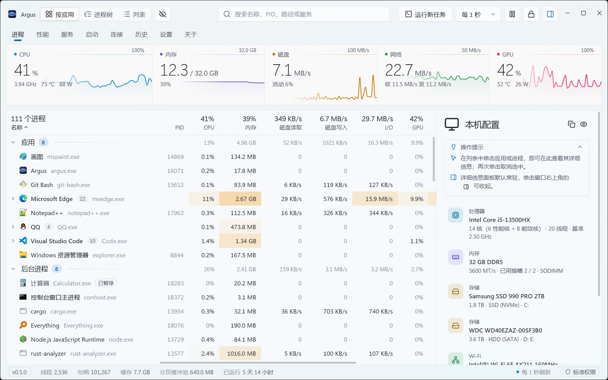

<div align="center">


# Argus

**快速、現代、資訊豐富的 Windows 工作管理員**

[简体中文](README.md) · **繁體中文** · [English](README.en.md) · [Español](README.es.md) · [Deutsch](README.de.md) · [日本語](README.ja.md) · [Français](README.fr.md) · [Русский](README.ru.md)

[](https://argustask.com/zh-TW/)

在[官方網站](https://argustask.com/zh-TW/)可直接透過瀏覽器體驗完整介面與功能導覽，無需下載安裝。

[](https://github.com/Ray-lea/Argus/releases)
[](https://github.com/Ray-lea/Argus/releases)
[](#system-requirements)
[](LICENSE)

<a href="https://trendshift.io/repositories/310031?utm_source=trendshift-badge&amp;utm_medium=badge&amp;utm_campaign=badge-trendshift-310031" target="_blank" rel="noopener noreferrer"></a>
<a href="https://trendshift.io/repositories/310031?utm_source=trendshift-badge&amp;utm_medium=badge&amp;utm_campaign=badge-trendshift-310031" target="_blank" rel="noopener noreferrer"></a>

[功能](#features) · [下載](#download) · [從原始碼建置](#build-from-source) · [快速鍵](#keyboard-shortcuts) · [文件](#documentation) · [交流與意見反應](#community)

</div>

<br>

<picture>
  <source media="(prefers-color-scheme: dark)" srcset="docs/images/screenshot-dark.png">
  
</picture>

預覽圖為簡體中文介面。

Argus 以 Rust 直接呼叫 Windows 原生介面，使用 GPUI Kit 原生元件建構介面，圖表折線隨螢幕更新率連續移動。專案名稱取自希臘神話中的百眼巨人阿爾戈斯（Argus Panoptes）。

## ⭐ Star 趨勢

若 Argus 對日常使用有所幫助，歡迎在 GitHub 上加上星標，支持專案並協助更多使用者發現 Argus。

<a href="https://www.star-history.com/#Ray-lea/Argus&Date">
  <picture>
    <source media="(prefers-color-scheme: dark)" srcset="https://api.star-history.com/svg?repos=Ray-lea/Argus&type=Date&theme=dark">
    
  </picture>
</a>

<a id="features"></a>

## ✨ 功能

<table>
<tr>
<td width="50%" valign="top"><picture><source media="(prefers-color-scheme: dark)" srcset="docs/images/features/processes-zh-TW-dark.svg"></picture><br><b>處理程序</b>：依應用程式、處理程序樹或清單檢視，支援搜尋、排序與結束處理程序樹</td>
<td width="50%" valign="top"><picture><source media="(prefers-color-scheme: dark)" srcset="docs/images/features/performance-zh-TW-dark.svg"></picture><br><b>效能</b>：CPU 各核心、時脈、溫度與功耗，以及記憶體、磁碟、網路與 GPU</td>
</tr>
<tr>
<td width="50%" valign="top"><picture><source media="(prefers-color-scheme: dark)" srcset="docs/images/features/history-zh-TW-dark.svg"></picture><br><b>歷程記錄</b>：按一下 7 天折線上的任意時刻，檢視當時最忙碌的處理程序</td>
<td width="50%" valign="top"><picture><source media="(prefers-color-scheme: dark)" srcset="docs/images/features/files-zh-TW-dark.svg"></picture><br><b>檔案使用狀況</b>：將檔案或資料夾拖放至視窗，列出使用它的處理程序</td>
</tr>
<tr>
<td width="50%" valign="top"><picture><source media="(prefers-color-scheme: dark)" srcset="docs/images/features/rules-zh-TW-dark.svg"></picture><br><b>快顯功能表</b>：設定優先順序、開啟效率模式，或新增規則於每次啟動時套用</td>
<td width="50%" valign="top"><picture><source media="(prefers-color-scheme: dark)" srcset="docs/images/features/ports-zh-TW-dark.svg"></picture><br><b>連線與連接埠</b>：依連接埠尋找連線及所屬處理程序，可直接中斷</td>
</tr>
</table>

<table>
<tr>
<td width="50%" valign="top"><b>服務與啟動項目</b><br>啟動、停止服務並修改啟動類型，啟用或停用啟動項目</td>
<td width="50%" valign="top"><b>常駐系統匣</b><br><kbd>Ctrl</kbd>+<kbd>Alt</kbd>+<kbd>Esc</kbd> 隨時顯示或隱藏視窗，隱藏時資源負擔極低</td>
</tr>
<tr>
<td width="50%" valign="top"><b>取代工作管理員</b><br>可<a href="docs/architecture/task-manager.md">取代 Windows 工作管理員</a>並回應 <kbd>Ctrl</kbd>+<kbd>Shift</kbd>+<kbd>Esc</kbd>（連結文件為簡體中文）；可執行新工作、重新啟動檔案總管</td>
<td width="50%" valign="top"><b>外觀與語言</b><br>Mica 材質，跟隨系統強調色與淺色、深色佈景主題；支援 8 種介面語言</td>
</tr>
<tr>
<td width="50%" valign="top"><b>應用程式內更新</b><br>穩定版與測試版通道，背景下載，可檢視更新內容</td>
<td width="50%" valign="top"><b>權限</b><br>以標準權限即可檢視全部處理程序；特殊權限服務與系統管理員執行可依需要開啟</td>
</tr>
</table>

<a id="download"></a>

## 📦 下載

在[官網下載頁](https://argustask.com/zh-TW/download/)取得最新穩定版及 SHA-256 總和檢查碼。全部版本見 [GitHub Releases](https://github.com/Ray-lea/Argus/releases)。

| 檔案 | 說明 |
|---|---|
| `Argus_<版本>_x64-setup.exe` | **安裝版（建議）**。為所有使用者安裝至 `Program Files`，安裝與更新需要系統管理員授權，支援應用程式內更新。 |
| `Argus_<版本>_x64.exe` | **免安裝版**。單一檔案直接執行，與安裝版共用設定及歷程資料，不支援自動更新。 |
| `SHA256SUMS.txt` | 上述發行檔案的 SHA-256 總和檢查碼。 |

[程式碼簽署政策（Code signing policy）](#code-signing-policy) · [隱私權政策（簡體中文）](PRIVACY.md#简体中文)

<a id="system-requirements"></a>

## 💻 系統需求

- **作業系統**：Windows 10 22H2（組建 19045）及更新版本（含 Windows 11），僅支援 x64 架構
- **圖形**：支援 DirectX 11 的圖形裝置與驅動程式

已驗證的系統版本、功能差異與權限需求詳見[相容範圍](docs/guide/hardware-data.md#系统兼容范围)（簡體中文）。

<a id="build-from-source"></a>

## 🔧 從原始碼建置

建置前需準備以下環境：

- Rust `stable-x86_64-pc-windows-msvc` 工具鏈（1.100.0 及以上）
- Node.js 26.13.1 及以上的 26.x 版本（亦支援 24.22.3 及以上的 24.x LTS）與 pnpm 12.18.0
- Visual Studio Build Tools（選取「使用 C++ 的桌面開發」工作負載）

在存放庫根目錄使用 PowerShell 執行：

```powershell
.\start.bat           # 開發模式：修改 Rust 與資源檔案後自動編譯並重新啟動；編譯失敗時保留目前執行個體
.\start.bat build     # 發行建置：產生 target\release\argus.exe
```

程式碼檢查、安裝程式封裝與快取清理等命令，詳見[開發指南](docs/development/README.md)（簡體中文）。

<a id="keyboard-shortcuts"></a>

## 🔑 快速鍵

| 操作 | 按鍵 |
|---|---|
| 切換頁面 | <kbd>Ctrl</kbd>+<kbd>1</kbd> … <kbd>Ctrl</kbd>+<kbd>8</kbd> |
| 搜尋處理程序 | <kbd>Ctrl</kbd>+<kbd>F</kbd> |
| 暫時停止重新整理 | 按住 <kbd>Ctrl</kbd>，放開後恢復（處理程序頁、效能頁） |
| 開啟詳細資料 | <kbd>Enter</kbd> |
| 結束處理程序 | <kbd>Alt</kbd>+<kbd>E</kbd> 或 <kbd>Delete</kbd>（<kbd>Shift</kbd>+<kbd>Delete</kbd> 略過確認） |
| 顯示或隱藏視窗（全域） | <kbd>Ctrl</kbd>+<kbd>Alt</kbd>+<kbd>Esc</kbd> |

完整按鍵清單可在「設定 → 快速鍵 → 檢視快速鍵」中查看；更多操作說明見[使用指南](docs/guide/README.md)（簡體中文）。

<a id="documentation"></a>

## 📚 文件

詳細文件使用簡體中文，可瀏覽[線上文件](https://argustask.com/docs/)（含穩定版與開發版）。

| 文件 | 內容概覽 |
|---|---|
| [使用指南](docs/guide/README.md) | 介面與操作、背景常駐與快速鍵、設定說明、硬體資料的來源與限制 |
| [開發指南](docs/development/README.md) | 開發環境與命令、建置與快取機制、效能基準與測量方法 |
| [架構](docs/architecture/README.md) | 系統分層與資料流、技術選型、各模組職責 |
| [設計](docs/design/README.md) | 設計原則、折線動畫、視窗外觀與材質 |
| [已知問題](docs/known-issues.md) | 目前版本的已知限制 |
| [更新記錄](changelog/zh-TW.md) | 歷次版本的詳細變更 |

<a id="community"></a>

## 💬 交流與意見反應

[](https://qm.qq.com/q/97YqJAQRNK) [](https://t.me/argustask)

歡迎加入 QQ 群組回報問題、提出建議或交流使用心得，或加入 Telegram 頻道取得版本更新與專案動態。也可透過應用程式的「關於 → 加入 QQ 群」或「關於 → 加入頻道」開啟。

## 🤝 參與貢獻

歡迎提交問題與提取要求，參與前請先閱讀[貢獻指南](.github/CONTRIBUTING.md)（簡體中文）。安全漏洞請依[安全政策](.github/SECURITY.md)（簡體中文）私下回報。

## 🧭 路線圖

已完成的里程碑與完整規劃見[路線圖](docs/roadmap.md)（簡體中文），目前推進及規劃中的工作包括：

- [ ] **硬體感測器擴充**：透過官方 PawnIO 驅動程式持續擴大消費級硬體的感測器涵蓋範圍；詳見[硬體支援範圍](docs/guide/hardware-data.md)（簡體中文）。
- [ ] **快速鍵擴充**：區分左右輔助按鍵，支援僅由輔助按鍵或兩個一般按鍵組成的組合。

<a id="code-signing-policy"></a>

## 🔐 程式碼簽署政策（Code signing policy）

免費程式碼簽署服務由 [SignPath.io](https://about.signpath.io/) 提供，程式碼簽署憑證由 [SignPath Foundation](https://signpath.org/) 提供。

Free code signing provided by [SignPath.io](https://about.signpath.io/), certificate by [SignPath Foundation](https://signpath.org/).

目前已接入測試簽署，正式發行仍使用未經 Windows Authenticode 簽署的檔案。正式簽署啟用後，簽署範圍為本存放庫原始碼經 GitHub Actions 建置的 Argus 主程式、工作管理員輔助程式、解除安裝程式與安裝程式；隨附的第三方程式保留原有簽章。

- **程式碼提交與審查（Committers and reviewers）**：[@Ray-lea](https://github.com/Ray-lea)，負責維護程式碼及審查外部貢獻。
- **簽署核准（Approvers）**：[@Ray-lea](https://github.com/Ray-lea)，負責手動核准每個正式簽署請求。
- **隱私權政策（Privacy policy）**：[简体中文](PRIVACY.md#简体中文) · [English](PRIVACY.md#english)。說明預設開啟的更新檢查、Proxy 後備連線、按需下載 PawnIO、主動意見反應，以及第三方服務的資料處理。

應用程式內更新使用獨立的 Minisign 發行金鑰驗證安裝套件與版本號；Windows Authenticode 用於驗證可執行檔的簽署者。

## 🙏 致謝

Argus 建構於以下開放原始碼專案之上，謹致謝忱：

| 專案 | 用途 |
|---|---|
| [GPUI Kit](https://gpui-kit.com/) | 原生桌面元件、視窗、表格與折線 |
| [windows-rs](https://github.com/microsoft/windows-rs) | Windows 原生介面的 Rust 繫結 |
| [Biome](https://biomejs.dev/)、[NSIS](https://nsis.sourceforge.io/) | 開發檢查與 Windows 封裝 |
| [serde](https://serde.rs/)、[reqwest](https://github.com/seanmonstar/reqwest) 等 Rust crate | 序列化、網路請求等基礎功能 |
| [PawnIO](https://pawnio.eu/)、[PawnIO.Modules](https://github.com/namazso/PawnIO.Modules) | 選用核心感測器所使用的簽署驅動程式與擷取模組 |
| [ZenStates-Core](https://github.com/irusanov/ZenStates-Core)、[LibreHardwareMonitor](https://github.com/LibreHardwareMonitor/LibreHardwareMonitor)、[GNR-SMU](https://github.com/Kyworn/gnr-smu) | AMD SMU 表等 CPU 暫存器配置參考 |
| [Intel IGCL](https://github.com/intel/drivers.gpu.control-library)、[AMD ADL](https://github.com/GPUOpen-LibrariesAndSDKs/display-library) | 顯示卡遙測介面 |

全部第三方元件及其授權條款聲明見 [THIRD-PARTY-NOTICES.txt](THIRD-PARTY-NOTICES.txt)。

感謝 [LINUX DO](https://linux.do/) 社群的支持。

<!-- supporters:start · node scripts/supporters.mjs -->
<p align="center">
  <a href="https://github.com/bronyaicu" target="_blank" rel="noopener"><picture><source media="(prefers-color-scheme: dark)" srcset="docs/images/supporters/bronyaicu-zh-TW-dark.svg"></picture></a>
</p>
<!-- supporters:end -->

## 📄 授權條款

Argus 為自由軟體，依據 [GNU Affero General Public License](LICENSE) 第 3 版或任何更新版本（`AGPL-3.0-or-later`）發布。

<a href="https://next.ossinsight.io/widgets/official/compose-recent-active-contributors?repo_id=1415551131&limit=30" target="_blank" style="display: block" align="center">
  <picture>
    <source media="(prefers-color-scheme: dark)" srcset="https://next.ossinsight.io/widgets/official/compose-recent-active-contributors/thumbnail.png?repo_id=1415551131&limit=30&image_size=auto&color_scheme=dark" width="655" height="auto">
    
  </picture>
</a>

<!-- Made with [OSS Insight](https://ossinsight.io/) -->

<div align="center">
<br>
<sub>Argus · Windows 工作管理員 · © 2026 Argus contributors</sub>
</div>
